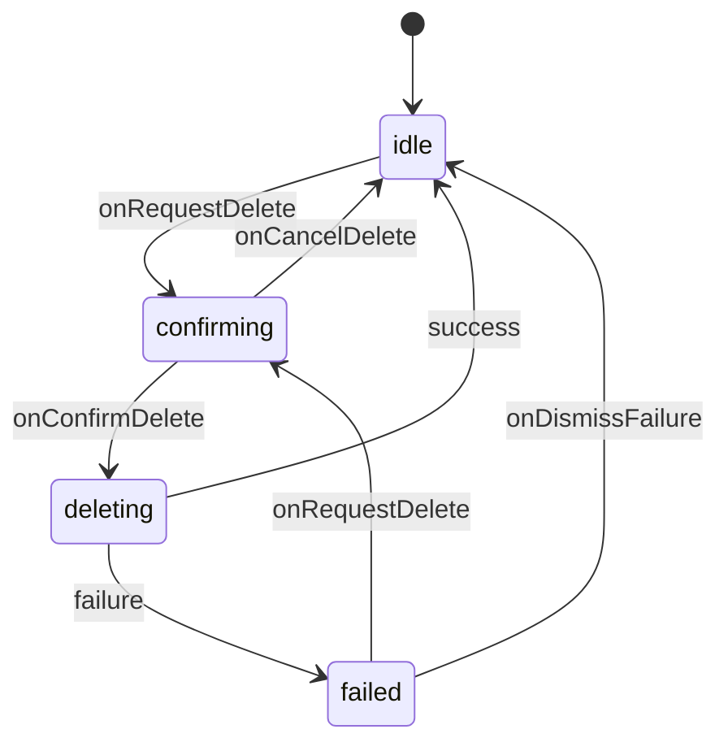
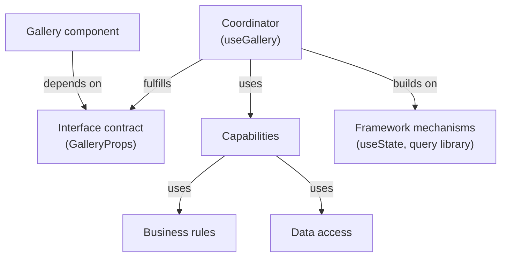
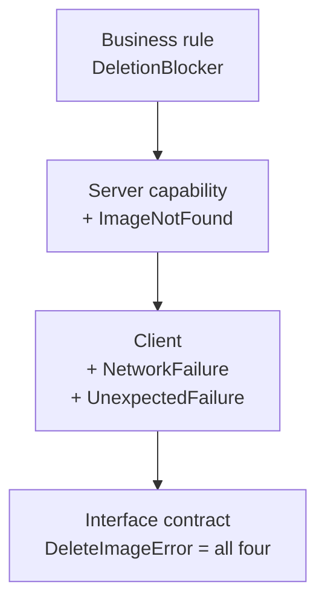

> 🇸🇰 [Slovenská verzia](README.sk.md)

# How I Think About Good Code Architecture

The change request is one sentence: images can no longer be deleted from an archived gallery either. In the code I show below, it touches four things. To change them correctly, I have to read the entire component, the server-side request handler, and every other place that deletes images.

This mismatch is how I judge architecture. Good architecture has clear boundaries and separated responsibilities: when changing or extending the application, a developer should only need to understand the parts of the system that are related to the change. If they also have to dig through a lot of unrelated things, I take it as a sign that the boundaries of responsibility aren't working well.

I'll show this with one small requirement and two ways to implement it. The second way has a cost, and for a simple screen I would stop earlier; I'll get to that too. The examples are in TypeScript and React.

## One requirement

The user can delete an image from a gallery. Before deleting it, the app asks them to confirm. Images are deleted one at a time: while one deletion is in progress, another one doesn't start. Images can't be deleted from a published gallery, and the user should be told why. When a deletion fails, they see the relevant reason.

## First version: everything in one component

The most direct approach is to write it where the user sees it:

```tsx
type DeleteFailure = {
  imageId: ImageId;
  reason: "gallery-published" | "image-not-found" | "network" | "unexpected";
};

function Gallery({ galleryId }: { galleryId: GalleryId }) {
  const { gallery, refetch } = useGalleryQuery(galleryId);

  // Local confirmation, deletion, and error state.
  const [confirmingImageId, setConfirmingImageId] =
    useState<ImageId | null>(null);
  const [deletingImageId, setDeletingImageId] = useState<ImageId | null>(null);
  const [failure, setFailure] = useState<DeleteFailure | null>(null);

  // The rule controls action availability and rendering.
  const isPublished = gallery?.status === "published";

  function handleRequestDelete(imageId: ImageId) {
    if (isPublished || deletingImageId !== null) return;

    setFailure(null);
    setConfirmingImageId(imageId);
  }

  async function handleConfirmDelete() {
    if (confirmingImageId === null) return;

    const imageId = confirmingImageId;
    setConfirmingImageId(null);
    setDeletingImageId(imageId);

    let reason: DeleteFailure["reason"] | null = null;

    // Call the server and map its response to a failure reason.
    try {
      const response = await fetch(
        `/api/galleries/${galleryId}/images/${imageId}`,
        { method: "DELETE" },
      );

      if (!response.ok) {
        const body = await response.json().catch(() => null);
        reason = body?.reason ?? "unexpected";
      }
    } catch {
      reason = "network";
    }

    // Keep the deletion in progress until the grid shows fresh data.
    if (reason) setFailure({ imageId, reason });
    else await refetch();

    setDeletingImageId(null);
  }

  return (
    <>
      {isPublished && (
        <Notice>Images can't be deleted from a published gallery.</Notice>
      )}

      <ImageGrid
        images={gallery?.images ?? []}
        deletingImageId={deletingImageId}
        onDelete={isPublished ? undefined : handleRequestDelete}
      />

      {!isPublished && confirmingImageId !== null && (
        <ConfirmDialog
          onConfirm={handleConfirmDelete}
          onCancel={() => setConfirmingImageId(null)}
        />
      )}

      {!isPublished && failure && (
        <ErrorMessage
          reason={failure.reason}
          onDismiss={() => setFailure(null)}
        />
      )}
    </>
  );
}
```

The publishing rule, the interaction state, the server call and the rendering all meet in one component. The server checks the same condition. It can't rely on the client-side check, because anyone can bypass it by calling the API directly.

## A change arrives

Later, the rule expands: images can't be deleted from an archived gallery either, and the user should see which of the two reasons applies.

The requirement is one sentence. In the code, it touches four things:

- the condition in the component,
- its copy on the server,
- the way the reason is represented: a yes or no is no longer enough, because there are two reasons,
- the text the user sees.

To change these four things correctly, I have to read more:

- the entire component, because `isPublished` is used in five places, and for each one I have to figure out whether it expresses the rule or just decides what gets rendered,
- the server-side request handler, to find the copy of the condition,
- every other component that deletes images, such as the image detail view, to find out whether it copied the condition.

## Two terms and one question

I name what just happened with two terms.

*Change surface* is the scope of a specific change, meaning what I have to modify: the places in the code, the contracts and the dependencies the change touches.

*Required context* is what I have to understand to make the change correctly: code, business rules, contracts and the relationships between them, including assumptions whose validity the change affects.

These are my working names. The first relates to what John Ousterhout calls *change amplification*, the second to his *cognitive load*; more on that in the note at the end.

The change surface of this change is the first list: the condition in the component and on the server, the representation of the reason, and the text. The required context is the second list. Besides the rule itself, I read the request handler and the rendering conditions to find out what I can safely change.

I use these terms as a thinking aid. The scope of a change and the amount of understanding it requires can't be measured directly in lines or files. But I want most of what I have to examine to be related to the change. A good contract lets me rely on a module's behavior without reading its implementation.

So I judge both a design and a code review by a single question:

> Is the context this change requires proportionate to what we're changing?

When extending the rule in the first version, I have to examine more than I'd like. Using the same gallery, I'll show how to narrow this context. I also give the roles in the design my own working names; I explain how they relate to established terms at the end.

## The method in one table

When designing, I work from the outside in, from the UI to the implementation. This direction is known as *outside-in*. Steve Freeman and Nat Pryce take a similar approach in their book *Growing Object-Oriented Software, Guided by Tests*, where they start the work on each feature with an acceptance test.

| Step | I ask | Outcome |
|---|---|---|
| 1. Interaction | What should the user be able to do, and how should the app respond? | a few sentences describing the behavior |
| 2. Interface contract | What does the UI need to know, and what can it trigger? | in the example, the `GalleryProps` type |
| 3. Capabilities | What must the system be able to do to fulfill the contract? | behavior named by intent |
| 4. Existing and missing capabilities | What does the system already provide, and what needs to be added? | a decision on what to reuse and what to build |
| 5. Coordinator | What needs to be wired together, and what interaction state needs to be held? | in the example, the `useGallery()` hook |
| Check | Is the context this change requires proportionate to what we're changing? | a few trial changes |

The table describes the order in which I think. It doesn't dictate the order of execution at runtime or the folder structure. When I find out what the system is missing, I sometimes go back to the interaction or the contract.

## Step 1: I start with the interaction

For the gallery, I start with the requirement from the introduction: the user deletes images one at a time and with a confirmation, can't delete from a published gallery, and sees the reason when a deletion fails. At this point I don't need to decide which hook I'll use or which endpoint I'll call.

From the required behavior, I derive the data, actions and states the UI needs. That becomes its contract.

## Step 2: the interface contract

The interface contract is the boundary between the UI and the rest of the application. For the gallery, it has to make it possible to:

- display the images and whether deletion is available, including the reason it's rejected,
- request a deletion, confirm it or cancel it,
- show deletion progress and any failure,
- dismiss the error.

The contract might look like this:

```ts
type GalleryProps = {
  images: Image[];
  deletion: ImageDeletion;
  canRequestDelete: boolean;
  onRequestDelete: (imageId: ImageId) => void;
  onConfirmDelete: () => void;
  onCancelDelete: () => void;
  onDismissFailure: () => void;
};

type ImageDeletion =
  | { status: "not-allowed"; blocker: DeletionBlocker }
  | { status: "idle" }
  | { status: "confirming"; imageId: ImageId }
  | { status: "deleting"; imageId: ImageId }
  | { status: "failed"; imageId: ImageId; error: DeleteImageError };

// Each reason is defined by the layer that can produce it.
type DeletionBlocker = { reason: "gallery-published" }; // business rule
type ImageNotFound = { reason: "image-not-found" }; // server capability
type NetworkFailure = { reason: "network" }; // client
type UnexpectedFailure = { reason: "unexpected" }; // client

type DeleteImageError =
  | DeletionBlocker
  | ImageNotFound
  | NetworkFailure
  | UnexpectedFailure;
```

The UI doesn't need to know the endpoint, the shape of the server response or the query library. It does, however, need to receive the outcomes it has to react to. If deletion isn't available, the user finds out why before even trying. When the connection fails, they know they can retry the deletion.

So named reasons cross the boundary. Status codes and headers stay behind it. The `DeleteImageError` type composes reasons from several layers; I'll get to each of them during the implementation.

The contract also includes the confirmation. In this example, I want it shared by all components that work with a single deletion interaction. When I keep it only in the component and when it belongs on the server is something I discuss below.

### Depth of the contract

Behind the contract sit loading the gallery, the publishing rule, the confirmation, deletion progress and telling errors apart. Its consumer should need to know considerably less than implementing all of this requires.

In his book *A Philosophy of Software Design*, John Ousterhout distinguishes between *deep modules* and *shallow modules*. A deep module provides a lot of behavior through a simple module interface. In his lecture notes for the Stanford CS 190 course from winter 2018, he describes a deep class as "small interface, lots of functionality". With a shallow module, the interface is almost as complex as what it hides.

The size of a contract isn't determined only by the number of properties. It also includes the meaning of the states and the rules about when each action can be called. These are exactly what determine how much context its consumer needs.

The `ImageDeletion` union partly encodes these rules in the type. Separate `confirmingImageId`, `deletingImageId` and `failure` values also allow combinations I don't want in this interaction. The union names its mutually exclusive states, so the reader doesn't have to infer their valid combinations from the event handlers.



The `not-allowed` state is missing from the diagram on purpose. It isn't stored; it's derived from the rule and overrides the other steps.

A deletion can be requested in the `idle` and `failed` states. The contract states this rule directly through `canRequestDelete`, so the component doesn't have to derive it from the state on its own.

### Naming

With the operation:

```ts
deleteImage(imageId);
```

I know what intent it expresses. With a more generic operation:

```ts
process({
  type: "delete",
  entity: image,
  options: {},
});
```

I have to understand additional conventions before I know how to use it.

In his book *Domain-Driven Design*, Eric Evans calls this pattern *Intention-Revealing Interfaces*. The name should say what the operation does and what it's for. Its caller then doesn't have to piece the intent together from implementation details.

## Step 3: capabilities

I use the word *capability* for behavior that the system provides. The gallery needs to:

- get the images,
- decide whether deletion is rejected, and why,
- delete an image and report the outcome.

A capability can take the form of a function, a service or several collaborating modules. The name alone doesn't prescribe an endpoint or a folder.

I distinguish between the behavior, its authoritative implementation and access to it. "Delete an image" is the behavior. In this application, the server performs it. The client needs an operation that calls the server, and its integration with the framework.

## Step 4: what the system already does and what it's missing

I can reuse an existing capability if its meaning and contract match the requirement. What's missing may be the whole behavior or only access to it: the server can already delete an image, but the client doesn't have a suitable operation yet.

Sometimes I need to extend the result. If the UI has to explain a rejection and the existing operation only returns yes or no, its contract isn't enough. A technical or conceptual constraint can also send me back to the interaction design.

In the gallery, I assume loading already exists. I add the publishing rule and image deletion. They show how a capability uses business rules and data access.

### Business rules

Business rules determine what the system may or must do. The rule "images can't be deleted from a published gallery" has to hold regardless of whether the operation is triggered by the UI, an API endpoint or a background job.

I keep rules like this in pure modules. They receive data as parameters and don't need a framework to be evaluated:

```ts
function getImageDeletionBlocker(gallery: Gallery): DeletionBlocker | null {
  if (gallery.status === "published") {
    return { reason: "gallery-published" };
  }

  return null;
}
```

The function returns a named reason that both the UI and the API can explain. The `DeletionBlocker` type belongs to the rule; the other layers take it from there. Since the function doesn't load or save anything, I can test it without React and call it from a hook, an API route and a script.

In his article *The Clean Architecture*, Robert C. Martin calls this direction of dependencies the Dependency Rule: source code dependencies point inward, toward the rules, and the rules know nothing about the framework.

The authoritative check has to happen where the data changes, in this case on the server. Anyone who calls the API directly bypasses a rule that exists only in the client.

The client mirrors it so that it doesn't offer the action and can explain why. In the next example, I assume the client and the server share the `getImageDeletionBlocker()` function and its types. That way, I change the rule in one place. If they don't share code, there are two implementations to keep in sync. The other option without sharing: the server sends deletion availability, along with the reason, directly in the gallery data, and the client doesn't evaluate the rule at all.

Even with shared code, the server makes the decision based on current data. That's why the contract accounts for a deletion being rejected even though the client considered it allowed.

### Data access

Data access is the boundary between application behavior and infrastructure. A capability depends on the repository contract and doesn't need to know the details of a database query, a cache read or a call to another service.

The split of responsibilities is visible in the capability that performs the deletion where the rule is authoritative:

```ts
// Server capability results only, excluding client connection failures.
type DeleteImageResult =
  | { ok: true }
  | { ok: false; error: DeletionBlocker | ImageNotFound };

async function deleteGalleryImage(
  galleryId: GalleryId,
  imageId: ImageId,
): Promise<DeleteImageResult> {
  // Returns null for an unknown gallery.
  const gallery = await galleryRepository.getGallery(galleryId);

  // The rule applies to this gallery, so the image must belong to it.
  const containsImage = gallery?.images.some((image) => image.id === imageId);

  if (!gallery || !containsImage) {
    return { ok: false, error: { reason: "image-not-found" } };
  }

  const blocker = getImageDeletionBlocker(gallery);

  if (blocker) {
    return { ok: false, error: blocker };
  }

  await galleryRepository.deleteImage(galleryId, imageId);

  return { ok: true };
}
```

`getImageDeletionBlocker()` evaluates the rule; the repository loads and changes the data. Checking that the image belongs to the gallery is part of the capability: without it, a caller could send the ID of an image from a published gallery together with the ID of a different, unpublished gallery. That's why I do it before the rule and report an unknown gallery the same way as an unknown image.

The result contains the reason taken from the rule and the capability's own `image-not-found` reason. An unexpected storage failure is still thrown as an exception; the client later converts it to `unexpected`.

The example leaves out two things. The first is authorization: who is allowed to delete is another, separate check in the same capability. The second is concurrent changes. Someone can publish the gallery between the read and the deletion. In real code, the check and the change therefore have to form an atomic operation, for example through a transaction with appropriate locking or a single conditional delete statement. Simply wrapping both steps in an arbitrary transaction doesn't provide that guarantee by itself. The mechanism is provided by the data access layer, depending on the storage in use.

This is how I apply the Single Responsibility Principle from SOLID. In his book *Clean Architecture*, Robert C. Martin points out that the principle doesn't mean a module should do only one thing. On his blog, he ties the reason to change to whom the module is responsible to: "This principle is about people." The publishing rule changes with gallery management requirements; the repository changes with storage requirements. Keeping them separate lets me handle these changes independently.

## Step 5: the Coordinator

The Coordinator connects capabilities to the interface contract. It calls the operations it needs, holds the interaction state, and passes data and actions to the UI. It uses business rules; it leaves the presentation to the component.

The role doesn't depend on a framework. In React, I implement it as a custom hook. If you know the split into container and presentational components, you'll recognize a similar role here; I explain how it relates to that pattern in the note at the end.



An arrow means "depends on". The component knows only the interface contract. Business rules and data access sit behind the capabilities and know nothing about React.

### The Coordinator in practice

| Capability | Authoritative implementation | Access from the Coordinator |
|---|---|---|
| get the gallery images | server | `useGalleryQuery` |
| decide whether deletion is rejected | `getImageDeletionBlocker()` on the server | the same function over client data |
| delete an image and report the outcome | `deleteGalleryImage()` on the server | `useDeleteGalleryImage` |

`useGalleryQuery` and `useDeleteGalleryImage` connect the capabilities to the query library. The second one looks like this:

```ts
// Client view of the result: server reasons plus connection failures.
type DeleteImageOutcome =
  | { ok: true }
  | { ok: false; error: DeleteImageError };

type ServerReason = (DeletionBlocker | ImageNotFound)["reason"];

// A Record makes TypeScript report a reason missing from this list.
const serverReasons: Record<ServerReason, true> = {
  "gallery-published": true,
  "image-not-found": true,
};

function parseServerReason(body: unknown): ServerReason | null {
  const reason = (body as { reason?: unknown } | null)?.reason;

  return typeof reason === "string" && Object.hasOwn(serverReasons, reason)
    ? (reason as ServerReason)
    : null;
}

async function requestImageDeletion(
  galleryId: GalleryId,
  imageId: ImageId,
): Promise<DeleteImageOutcome> {
  try {
    const response = await fetch(
      `/api/galleries/${galleryId}/images/${imageId}`,
      { method: "DELETE" },
    );

    if (response.ok) return { ok: true };

    const body: unknown = await response.json().catch(() => null);
    const reason = parseServerReason(body) ?? "unexpected";

    return { ok: false, error: { reason } };
  } catch {
    return { ok: false, error: { reason: "network" } };
  }
}

function useDeleteGalleryImage(galleryId: GalleryId) {
  const { refetch } = useGalleryQuery(galleryId);

  return async (imageId: ImageId): Promise<DeleteImageOutcome> => {
    const outcome = await requestImageDeletion(galleryId, imageId);

    // Refresh after success and after any answer that proves stale data.
    if (outcome.ok || outcome.error.reason !== "network") await refetch();

    return outcome;
  };
}
```

This is the same logic the first version had in its confirm handler, plus validation of the server response. The second version didn't get rid of it; it moved it behind the operation's contract.

This operation comes with two guarantees. It returns every deletion failure as a result, and its Promise never rejects. And the Promise resolves only after the gallery has been refetched, so the deleted image disappears from the grid before another deletion can be requested. Any error from that refetch belongs to the gallery's loading state, not to the result of a deletion that has already completed.

In a project with a library that has mutations, such as TanStack Query, `useMutation` would take this place. Its `mutateAsync`, however, rejects the Promise on error, so I would wrap it in the integration to keep that guarantee. I keep my own union on top of the mutation because it also combines the confirmation and the rule into a single state, and the mutation knows nothing about either of them.

```ts
// "not-allowed" is derived from the rule, not stored in state.
type DeletionStep = Exclude<ImageDeletion, { status: "not-allowed" }>;

function useGallery(galleryId: GalleryId): GalleryProps {
  // Access server data and operations.
  const { gallery } = useGalleryQuery(galleryId);
  const deleteImage = useDeleteGalleryImage(galleryId);
  // Evaluate the rule using client data.
  const blocker = gallery ? getImageDeletionBlocker(gallery) : null;

  // State of a single deletion interaction.
  const [step, setStep] = useState<DeletionStep>({ status: "idle" });

  // Single source for when a deletion can be requested.
  const canRequestDelete =
    !blocker && (step.status === "idle" || step.status === "failed");

  function requestDelete(imageId: ImageId) {
    if (!canRequestDelete) return;

    setStep({ status: "confirming", imageId });
  }

  async function confirmDelete() {
    if (blocker || step.status !== "confirming") return;

    const { imageId } = step;
    setStep({ status: "deleting", imageId });

    // The integration returns every failure as a result.
    const outcome = await deleteImage(imageId);

    setStep(
      outcome.ok
        ? { status: "idle" }
        : { status: "failed", imageId, error: outcome.error },
    );
  }

  function cancelDelete() {
    if (step.status === "confirming") setStep({ status: "idle" });
  }

  function dismissFailure() {
    if (step.status === "failed") setStep({ status: "idle" });
  }

  // Fulfill the interface contract.
  return {
    images: gallery?.images ?? [],
    // A business rule blocker takes precedence in the UI.
    deletion: blocker ? { status: "not-allowed", blocker } : step,
    canRequestDelete,
    onRequestDelete: requestDelete,
    onConfirmDelete: confirmDelete,
    onCancelDelete: cancelDelete,
    onDismissFailure: dismissFailure,
  };
}
```

The `Gallery` component works only with this contract:

```tsx
// A Record makes TypeScript report a reason without a text.
const reasonTexts: Record<DeleteImageError["reason"], string> = {
  "gallery-published": "Images can't be deleted from a published gallery.",
  "image-not-found":
    "The image wasn't found. Someone may have deleted it in the meantime.",
  network: "The connection failed. Please try again.",
  unexpected: "The image couldn't be deleted.",
};

function Gallery({
  images,
  deletion,
  canRequestDelete,
  onRequestDelete,
  onConfirmDelete,
  onCancelDelete,
  onDismissFailure,
}: GalleryProps) {
  return (
    <>
      {deletion.status === "not-allowed" && (
        <Notice>{reasonTexts[deletion.blocker.reason]}</Notice>
      )}

      <ImageGrid
        images={images}
        deletingImageId={
          deletion.status === "deleting" ? deletion.imageId : null
        }
        onDelete={canRequestDelete ? onRequestDelete : undefined}
      />

      {deletion.status === "confirming" && (
        <ConfirmDialog
          onConfirm={onConfirmDelete}
          onCancel={onCancelDelete}
        />
      )}

      {deletion.status === "failed" && (
        <ErrorMessage
          text={reasonTexts[deletion.error.reason]}
          onDismiss={onDismissFailure}
        />
      )}
    </>
  );
}

function GalleryScreen({ galleryId }: { galleryId: GalleryId }) {
  const gallery = useGallery(galleryId);

  return <Gallery {...gallery} />;
}
```

`reasonTexts` turns a named reason into text for the user, the same way for a rejection and for a failure. The component decides whether to show the dialog and the error, but it doesn't need to know the publishing status or the server response to make that decision.

A single `useGallery()` instance owns the interaction state. If both the grid and the image detail view offer deletion, I pass both of them the actions and state from the same instance, through props or React Context. Two separate calls to the hook would create two independent interactions. Here, confirmation and one-at-a-time deletion are properties of the shared flow within one screen; concurrency across tabs or users has to be handled by the server.

Two paths lead out of the `failed` state: a new request goes to `confirming`, dismissing the error goes to `idle`. The Coordinator relies on the first guarantee here: if the operation threw an exception, it would stay stuck in the `deleting` state.

The example simplifies two things. It leaves out loading the gallery and errors when fetching it; in a complete contract, those would have their own states. And it doesn't handle the rule changing during the interaction. If someone publishes the gallery while the confirmation is open or during the deletion, `not-allowed` overrides the step, but the stored step remains. In real code, I would discard the pending confirmation so that it doesn't come back after the gallery is unpublished.

### Where failure reasons come from

Each reason is defined by the layer that can produce it. The error type grows on its way to the UI:



The contract uses the resulting types; the Coordinator passes them through. Thanks to that, the business rule doesn't need to know about network errors or UI states.

## Where confirmation belongs

Confirmation before deletion can belong to the component, the Coordinator or the server capability. I decide based on what it is supposed to guarantee.

If it's a visual safeguard in a single component, I keep the dialog state in that component. The contract is smaller, and when I change the dialog I don't need to know the rest of the interaction.

If every deletion in a shared interaction has to go through confirmation, I put it in the Coordinator and its contract. The grid and the detail view then both request a deletion through the same action. The Coordinator holds the `confirming` step, and the component decides how to display it. This arrangement holds for the components wired into the shared flow; the mere existence of the hook doesn't stop other code from calling the capability directly.

This kind of confirmation protects people from misclicks. The server can't verify that a person saw the dialog: a script can send a "user confirmed" flag too.

Sometimes, though, the confirmation expresses a business rule. If the image is also used elsewhere, the rule might read: "An image can be deleted only after confirming the current list of places it will disappear from." The server then sends the list of usages together with its version, which changes every time the usages change, and requires that version back on deletion. HTTP has a conditional request for exactly this:

```http
DELETE /api/galleries/summer/images/42
If-Match: "usages-v7"
```

If another usage has been added in the meantime, the version doesn't match and the server rejects the deletion with `412 Precondition Failed`. The interface contract gains another named reason, such as `usages-changed`. The version comparison and the deletion again have to form an atomic operation.

This way, the server guarantees that the confirmed scope matches the current state. It can't tell whether anyone actually saw the list; a script that loads the usages sends the same header. Displaying the list belongs to the UI; checking the confirmed scope belongs to the capability.

## Check: back to the question

I judge boundaries against concrete changes. For both versions, I look at what I have to modify and what I have to understand first.

### Trial changes

The following comparison assumes that the rule's implementation is shared between client and server, and that a single Coordinator instance serves the components involved in deletion.

**1. The look of the confirmation dialog**

- One component: the dialog component, and possibly where it's used in `Gallery`.
- Version with boundaries: the same places. Separating out the Coordinator doesn't add much here.

**2. Confirmation only for the cover image**

- One component: the request and confirm handlers and how they relate to rendering.
- Version with boundaries: the confirmation decision in `useGallery()`, or possibly a pure function `requiresDeleteConfirmation()`. The contract can stay the same.

**3. Images can't be deleted from an archived gallery either**

- One component: the condition in the component, its copy on the server, the representation of the reason and the text. I also search for other copies of the rule.
- Version with boundaries: `getImageDeletionBlocker()` and the `DeletionBlocker` type. TypeScript points me to the missing text in `reasonTexts` and the missing reason in `serverReasons`.

**4. A different endpoint for deletion**

- One component: the server call in the confirm handler and any copies of it.
- Version with boundaries: the client operation `requestImageDeletion()`.

With the third change, the one from the introduction, I no longer have to infer the rule from rendering conditions. I change its named function and extend the type. The compiler shows me the places that need to know about the new reason, because both lists are a `Record` over all reasons. A `switch` with a `default` branch alone wouldn't guarantee that.

I also verify that the server and the client use the shared implementation. If they don't share code, I have to update both implementations; named boundaries help me find them, but they don't remove that work.

### What each decision brought

To improve the third change, I don't need the whole second solution. Just extracting `getImageDeletionBlocker()` and naming the reason helps, even if I leave the rest in one component. For a single screen, I would happily stop at this intermediate step.

Further decisions solve further problems. The client operation hides the endpoint and the response mapping. The union limits the combinations of states I have to keep track of. The contract makes it possible to change and try out the presentation independently. A shared Coordinator unifies the deletion flow across multiple components.

So I treat the comparison as an illustration of what specific boundaries bring. Their number alone doesn't determine quality. When extending the rule, I want to understand the rule, its outcomes and the places that rely on it. If that forces me to untangle the HTTP request and the dialog lifecycle as well, the context I need grows for no good reason.

### Tests as a second lens

Writing a test often tells me what context a change requires. In the gallery, I would verify the boundaries like this:

- I test the pure function `getImageDeletionBlocker()` on a few galleries, without React or the network.
- I test the server-side `deleteGalleryImage()` with an in-memory repository. A published gallery must reject the deletion, and both an image from another gallery and an unknown gallery must end up as `image-not-found`. I verify the correctness of concurrent operations separately, against real storage.
- For `useGallery()`, I replace the integrations. I verify confirmation, cancellation, rejection of another request during confirmation and deletion, and that the failure reason is passed through. With multiple consumers, I verify that they use a shared instance.
- I verify the `useDeleteGalleryImage` integration against a stubbed server: a connection failure and an unknown response must end up as a result, not a rejected Promise, and after success the Promise must resolve only after the gallery has been refetched.
- I render `Gallery` with static props for each `ImageDeletion` state, for example in Storybook.

If a test of the rule itself requires rendering a screen or setting up an HTTP server, I look into whether unrelated responsibilities have attached themselves to it.

Some boundaries can also be guarded by dependency rules, for example in dependency-cruiser: a component must not access data directly, and a pure rules module must not have a runtime dependency on the framework. The tool flags a violation before it turns into the usual way of working.

### What it costs

A single delete button ended up with a component, a screen, a hook, a rule, a server capability and two integrations. These boundaries have to be named, maintained, and found on a first read.

Steps 1 and 2 almost always pay off for me: they clarify the behavior and what the UI needs. I add further boundaries when a rule shows up that applies beyond the screen, an interaction shared by several components, or a change that forced me to read too much. For a simple screen, most of the code can stay together.

Sometimes a change legitimately touches several responsibilities, for example when I change both the rules and the results of an operation. For a small, local change, though, I expect most of the system to stay outside what I have to examine.

Where helper functions belong and when it makes sense to extract a function is something I cover in a separate piece, "When Extracting a Function Makes Sense".

I ask myself the same question for a single button and for the modules of an entire application:

> Is the context this change requires proportionate to what we're changing?

## A note on terms

The approach in this article builds on well-known principles: hiding implementation details, separation of concerns, naming operations by intent, and designing from the outside in (*outside-in*). I apply these principles to the design of one specific interaction.

I use *change surface* for the scope of a specific change. It relates to Ousterhout's *change amplification*: if a simple requirement calls for modifications in many places, the scope of the change reveals a problem in the design. I use *required context* for what a developer has to understand before making a change. It's close to what Ousterhout describes as *cognitive load*. The third symptom of complexity he names, *unknown unknowns*, showed up in the example when searching for other copies of the rule: I don't know in advance everywhere I need to look. My two names help me separate two questions: what I have to change, and what I have to understand in order to change it.

*Capability* here means behavior the system provides through a usable contract. *Coordinator* is the name of the role that combines these behaviors and owns the interaction state. In the example, a custom hook fills that role. I use these names to explain responsibilities in the design; they don't prescribe a particular framework or file structure.

The Coordinator is close to what Dan Abramov described in 2015 as a container component. In a 2019 update, he himself writes that he no longer recommends splitting components this way and that hooks now take care of separating stateful logic. The Coordinator in this article is exactly such a hook. I separate the presentational component for the sake of the contract and the ability to try out the presentation independently; the pattern alone wouldn't be reason enough for me.

## Sources

- John Ousterhout: *A Philosophy of Software Design*, Yaknyam Press, April 2018 ([the author's list of publications](https://web.stanford.edu/%7Eouster/cgi-bin/publications.php)).
- John Ousterhout: [Modular Design](https://web.stanford.edu/~ouster/cgi-bin/cs190-winter18/lecture.php?topic=modularDesign), lecture notes for CS 190, Stanford University, Winter 2018.
- Robert C. Martin: *Clean Architecture*, Pearson, 2017, Chapter 7 ([chapter preview from the publisher](https://www.oreilly.com/library/view/clean-architecture-a/9780134494272/ch7.xhtml)).
- Robert C. Martin: [The Single Responsibility Principle](https://blog.cleancoder.com/uncle-bob/2014/05/08/SingleReponsibilityPrinciple.html), Clean Coder blog, May 8, 2014.
- Robert C. Martin: [The Clean Architecture](https://blog.cleancoder.com/uncle-bob/2012/08/13/the-clean-architecture.html), Clean Coder blog, August 13, 2012.
- Eric Evans: *Domain-Driven Design*, Addison-Wesley, 2003, the Intention-Revealing Interfaces pattern ([summary in the Domain-Driven Design Reference](https://domainlanguage.com/wp-content/uploads/2016/05/DDD_Reference_2015-03.pdf)).
- Steve Freeman, Nat Pryce: *Growing Object-Oriented Software, Guided by Tests*, Addison-Wesley, 2009, Chapter 5 ([table of contents](https://growing-object-oriented-software.com/toc.html)).
- Dan Abramov: [Presentational and Container Components](https://medium.com/@dan_abramov/7ca2f9a7c7d0), March 23, 2015, with a 2019 update.
- TanStack Query: [Mutations](https://tanstack.com/query/v5/docs/react/guides/mutations), documentation, behavior of `mutateAsync` on error.
- [dependency-cruiser](https://github.com/sverweij/dependency-cruiser), a tool for checking dependency rules.
