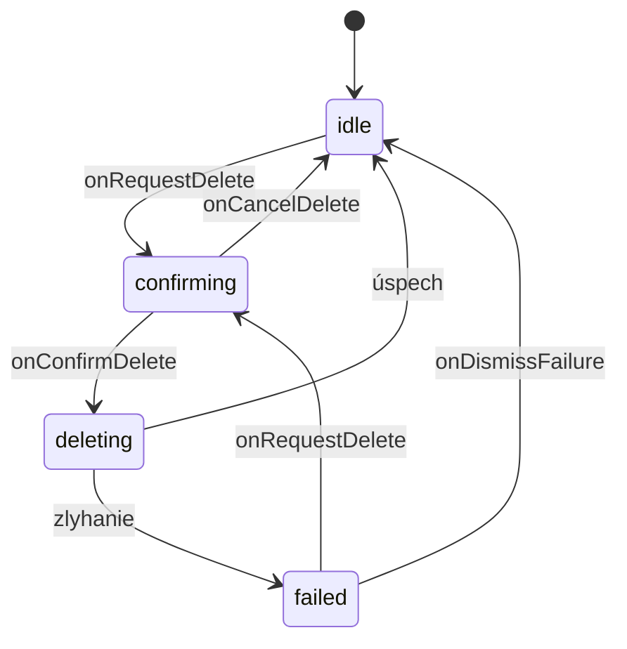
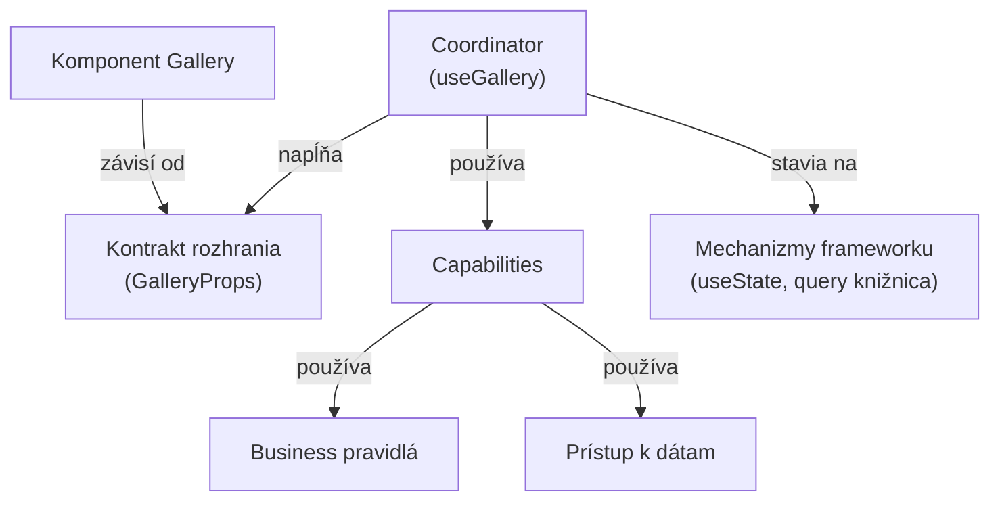
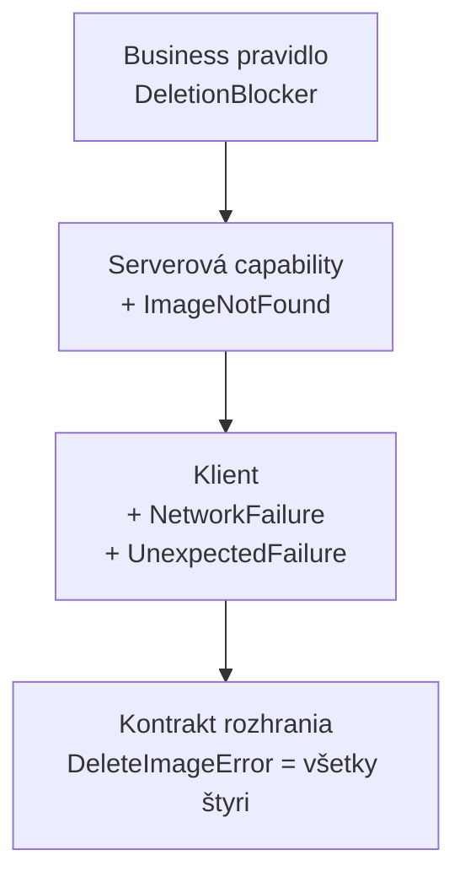

> 🇬🇧 [English version](README.md)

# Ako vnímam dobrú architektúru kódu

Zmena zadania má jednu vetu: mazať sa nebude dať ani z archivovanej galérie. V kóde, ktorý ukážem nižšie, sa dotkne štyroch vecí. Aby som ich zmenil správne, musím prečítať celý komponent, obsluhu požiadavky na serveri a každé ďalšie miesto, ktoré obrázky maže.

Podľa tohto nepomeru posudzujem architektúru. Dobrá architektúra má jasné hranice a oddelené zodpovednosti: pri zmene alebo rozšírení aplikácie má vývojárovi stačiť porozumieť tým častiam systému, ktoré so zmenou súvisia. Ak musí skúmať aj množstvo nesúvisiacich vecí, je to pre mňa signál, že hranice zodpovedností nefungujú dobre.

Ukážem to na jednej malej požiadavke a na dvoch spôsoboch, ako ju naprogramovať. Druhý spôsob niečo stojí a pri jednoduchej obrazovke by som zastal skôr; aj k tomu sa dostanem. Príklady sú v TypeScripte a Reacte.

## Jedna požiadavka

Používateľ môže vymazať obrázok z galérie. Pred vymazaním ho aplikácia požiada o potvrdenie. Maže po jednom: kým jedno vymazanie prebieha, ďalšie nezačne. Z publikovanej galérie sa mazať nedá a používateľ sa má dozvedieť prečo. Keď vymazanie zlyhá, dozvie sa relevantný dôvod.

## Prvá verzia: všetko v jednom komponente

Najpriamejšie je napísať to tam, kde to používateľ vidí:

```tsx
type DeleteFailure = {
  imageId: ImageId;
  reason: "gallery-published" | "image-not-found" | "network" | "unexpected";
};

function Gallery({ galleryId }: { galleryId: GalleryId }) {
  const { gallery, refetch } = useGalleryQuery(galleryId);

  // Local confirmation, deletion, and error state.
  const [confirmingImageId, setConfirmingImageId] =
    useState<ImageId | null>(null);
  const [deletingImageId, setDeletingImageId] = useState<ImageId | null>(null);
  const [failure, setFailure] = useState<DeleteFailure | null>(null);

  // The rule controls action availability and rendering.
  const isPublished = gallery?.status === "published";

  function handleRequestDelete(imageId: ImageId) {
    if (isPublished || deletingImageId !== null) return;

    setFailure(null);
    setConfirmingImageId(imageId);
  }

  async function handleConfirmDelete() {
    if (confirmingImageId === null) return;

    const imageId = confirmingImageId;
    setConfirmingImageId(null);
    setDeletingImageId(imageId);

    let reason: DeleteFailure["reason"] | null = null;

    // Call the server and map its response to a failure reason.
    try {
      const response = await fetch(
        `/api/galleries/${galleryId}/images/${imageId}`,
        { method: "DELETE" },
      );

      if (!response.ok) {
        const body = await response.json().catch(() => null);
        reason = body?.reason ?? "unexpected";
      }
    } catch {
      reason = "network";
    }

    // Keep the deletion in progress until the grid shows fresh data.
    if (reason) setFailure({ imageId, reason });
    else await refetch();

    setDeletingImageId(null);
  }

  return (
    <>
      {isPublished && <Notice>Z publikovanej galérie sa nedá mazať.</Notice>}

      <ImageGrid
        images={gallery?.images ?? []}
        deletingImageId={deletingImageId}
        onDelete={isPublished ? undefined : handleRequestDelete}
      />

      {!isPublished && confirmingImageId !== null && (
        <ConfirmDialog
          onConfirm={handleConfirmDelete}
          onCancel={() => setConfirmingImageId(null)}
        />
      )}

      {!isPublished && failure && (
        <ErrorMessage
          reason={failure.reason}
          onDismiss={() => setFailure(null)}
        />
      )}
    </>
  );
}
```

V jednom komponente sa stretli pravidlo o publikovaní, stav interakcie, volanie servera aj vykreslenie. Rovnakú podmienku overuje aj server. Na kontrolu v klientovi sa nemôže spoliehať, pretože ju možno obísť priamym volaním API.

## Príde zmena

Neskôr sa pravidlo rozšíri: mazať sa nebude dať ani z archivovanej galérie a používateľ má vidieť, o ktorý z dvoch dôvodov ide.

Zadanie je jedna veta. V kóde sa dotkne štyroch vecí:

- podmienky v komponente,
- jej kópie na serveri,
- spôsobu, akým sa dôvod reprezentuje: áno alebo nie už nestačí, lebo dôvody sú dva,
- textu, ktorý používateľ vidí.

Aby som tieto štyri veci zmenil správne, musím toho prečítať viac:

- celý komponent, lebo `isPublished` sa v ňom používa na piatich miestach a pri každom musím zistiť, či vyjadruje pravidlo, alebo len rozhoduje, čo sa zobrazí,
- obsluhu požiadavky na serveri, aby som kópiu podmienky našiel,
- každý ďalší komponent, ktorý obrázky maže, napríklad detail obrázka, aby som zistil, či si podmienku skopíroval.

## Dva pojmy a jedna otázka

To, čo sa práve stalo, pomenúvam dvoma pojmami.

*Change surface* je rozsah konkrétnej zmeny, teda to, čo musím upraviť: miesta v kóde, kontrakty a závislosti, ktoré zmena zasiahne.

*Required context* je to, čo musím pochopiť, aby som zmenu urobil správne: kód, business pravidlá, kontrakty a vzťahy medzi nimi vrátane predpokladov, ktorých platnosť zmena ovplyvní.

Sú to moje pracovné názvy. Prvý súvisí s tým, čo John Ousterhout nazýva *change amplification*, druhý s jeho *cognitive load*; viac v poznámke na konci.

Change surface tejto zmeny je prvý zoznam: podmienka v komponente aj na serveri, reprezentácia dôvodu a text. Required context je druhý zoznam. Okrem samotného pravidla čítam obsluhu požiadavky a podmienky vykreslenia, aby som zistil, čo môžem bezpečne zmeniť.

Tieto pojmy používam ako pomôcku pri uvažovaní. Rozsah zmeny a množstvo potrebného porozumenia sa nedajú priamo merať počtom riadkov ani súborov. Chcem však, aby väčšina toho, čo musím skúmať, súvisela so zmenou. Dobrý kontrakt mi umožní spoľahnúť sa na správanie modulu bez čítania jeho implementácie.

Návrh aj code review preto posudzujem jednou otázkou:

> Je kontext potrebný na túto zmenu primeraný tomu, čo meníme?

Pri rozšírení pravidla v prvej verzii musím skúmať viac, než by som chcel. Na tej istej galérii ukážem, ako tento kontext zúžiť. Aj roly v návrhu pomenúvam vlastnými pracovnými názvami; ich vzťah k zaužívaným pojmom uvádzam na konci.

## Metóda v jednej tabuľke

Pri návrhu postupujem zvonka dovnútra, od používateľského rozhrania k implementácii. Tento smer je známy ako *outside-in*. Podobne postupujú Steve Freeman a Nat Pryce v knihe *Growing Object-Oriented Software, Guided by Tests*, kde prácu na každej funkcii začínajú akceptačným testom.

| Krok | Pýtam sa | Výsledok |
|---|---|---|
| 1. Interakcia | Čo má používateľ vedieť urobiť a ako má aplikácia reagovať? | pár viet o správaní |
| 2. Kontrakt rozhrania | Čo používateľské rozhranie potrebuje vedieť a čo môže spustiť? | v príklade typ `GalleryProps` |
| 3. Capabilities | Čo musí systém vedieť, aby kontrakt naplnil? | správanie pomenované podľa zámeru |
| 4. Existujúce a chýbajúce capabilities | Čo už systém poskytuje a čo treba doplniť? | rozhodnutie, čo použiť a čo vytvoriť |
| 5. Coordinator | Čo treba prepojiť a aký stav interakcie držať? | v príklade hook `useGallery()` |
| Kontrola | Je kontext potrebný na zmenu primeraný tomu, čo meníme? | niekoľko skúšobných zmien |

Tabuľka opisuje poradie, v ktorom premýšľam. Neurčuje poradie vykonávania za behu ani štruktúru priečinkov. Keď zistím, čo systému chýba, niekedy sa vrátim k interakcii alebo kontraktu.

## Krok 1: začínam interakciou

Pri galérii začínam požiadavkou z úvodu: používateľ maže obrázok s potvrdením a po jednom, z publikovanej galérie mazať nesmie a pri zlyhaní vidí dôvod. Zatiaľ nemusím rozhodovať, ktorý hook použijem ani aký endpoint zavolám.

Z požadovaného správania odvodím údaje, akcie a stavy, ktoré potrebuje používateľské rozhranie. Tým vzniká jeho kontrakt.

## Krok 2: kontrakt rozhrania

Kontrakt rozhrania tvorí hranicu medzi používateľským rozhraním a zvyškom aplikácie. Pri galérii musí umožniť:

- zobraziť obrázky a dostupnosť mazania vrátane dôvodu odmietnutia,
- požiadať o vymazanie, potvrdiť ho alebo zrušiť,
- ukázať priebeh mazania a prípadné zlyhanie,
- zavrieť chybu.

Kontrakt môže vyzerať takto:

```ts
type GalleryProps = {
  images: Image[];
  deletion: ImageDeletion;
  canRequestDelete: boolean;
  onRequestDelete: (imageId: ImageId) => void;
  onConfirmDelete: () => void;
  onCancelDelete: () => void;
  onDismissFailure: () => void;
};

type ImageDeletion =
  | { status: "not-allowed"; blocker: DeletionBlocker }
  | { status: "idle" }
  | { status: "confirming"; imageId: ImageId }
  | { status: "deleting"; imageId: ImageId }
  | { status: "failed"; imageId: ImageId; error: DeleteImageError };

// Each reason is defined by the layer that can produce it.
type DeletionBlocker = { reason: "gallery-published" }; // business rule
type ImageNotFound = { reason: "image-not-found" }; // server capability
type NetworkFailure = { reason: "network" }; // client
type UnexpectedFailure = { reason: "unexpected" }; // client

type DeleteImageError =
  | DeletionBlocker
  | ImageNotFound
  | NetworkFailure
  | UnexpectedFailure;
```

Používateľské rozhranie nepotrebuje poznať endpoint, tvar odpovede servera ani query knižnicu. Musí však dostať výsledky, na ktoré má reagovať. Ak mazanie nie je dostupné, používateľ sa ešte pred pokusom dozvie prečo. Pri zlyhaní spojenia vie, že môže skúsiť vymazanie znova.

Cez hranicu preto prechádzajú pomenované dôvody. Stavové kódy a hlavičky zostávajú za ňou. Typ `DeleteImageError` skladá dôvody z viacerých vrstiev; ku každej sa dostanem pri implementácii.

Kontrakt obsahuje aj potvrdenie. V tomto príklade chcem, aby ho zdieľali všetky komponenty, ktoré pracujú s jednou interakciou mazania. Kedy ho nechávam iba v komponente a kedy patrí až na server, rozoberám nižšie.

### Hĺbka kontraktu

Za kontraktom stojí načítanie galérie, pravidlo o publikovaní, potvrdenie, priebeh mazania a rozlíšenie chýb. Jeho používateľovi má stačiť vedieť podstatne menej, než vyžaduje implementácia týchto činností.

John Ousterhout v knihe *A Philosophy of Software Design* rozlišuje *deep modules* a *shallow modules*. Deep module poskytuje veľa správania cez jednoduché rozhranie modulu. V poznámkach k prednáške kurzu CS 190 na Stanforde zo zimy 2018 opisuje hlbokú triedu slovami „small interface, lots of functionality“. Pri shallow module je rozhranie takmer také zložité ako to, čo skrýva.

Veľkosť kontraktu pritom neurčuje len počet vlastností. Patria k nemu aj význam stavov a dohody o tom, kedy možno jednotlivé akcie volať. Práve od nich závisí, koľko kontextu potrebuje jeho používateľ.

Union `ImageDeletion` tieto dohody čiastočne zapisuje do typu. Samostatné hodnoty `confirmingImageId`, `deletingImageId` a `failure` pripúšťajú aj kombinácie, ktoré v tejto interakcii nechcem. Union pomenúva jej vzájomne sa vylučujúce stavy, takže čitateľ nemusí odvodzovať ich platné kombinácie z obsluhy udalostí.



Stav `not-allowed` v diagrame chýba zámerne. Neukladá sa, odvodzuje sa z pravidla a ostatné kroky prekrýva.

O vymazanie možno požiadať v stavoch `idle` a `failed`. Túto dohodu kontrakt hovorí priamo cez `canRequestDelete`, aby ju komponent nemusel odvodzovať zo stavu sám.

### Pomenovanie

Pri operácii:

```ts
deleteImage(imageId);
```

viem, aký zámer vyjadruje. Pri všeobecnejšej operácii:

```ts
process({
  type: "delete",
  entity: image,
  options: {},
});
```

musím pochopiť ďalšie konvencie, aby som vedel, ako ju použiť.

Eric Evans tento vzor v knihe *Domain-Driven Design* nazýva *Intention-Revealing Interfaces*. Názov má hovoriť, čo operácia robí a načo je. Jej používateľ potom nemusí zámer skladať z implementačných detailov.

## Krok 3: capabilities

Slovom *capability* označujem správanie, ktoré systém poskytuje. Galéria potrebuje:

- získať obrázky,
- rozhodnúť, či a prečo je vymazanie odmietnuté,
- vymazať obrázok a oznámiť výsledok.

Capability môže mať podobu funkcie, služby alebo viacerých spolupracujúcich modulov. Samotný názov nepredpisuje endpoint ani priečinok.

Rozlišujem pritom správanie, jeho autoritatívnu implementáciu a prístup k nej. „Vymazať obrázok“ je správanie. V tejto aplikácii ho vykonáva server. Klient potrebuje operáciu, ktorá server zavolá, a jej napojenie na framework.

## Krok 4: čo už systém vie a čo mu chýba

Existujúcu capability môžem použiť, ak jej význam a kontrakt zodpovedajú požiadavke. Chýbať môže celé správanie alebo iba prístup k nemu: server už vie obrázok vymazať, ale klient ešte nemá vhodnú operáciu.

Niekedy potrebujem doplniť výsledok. Ak má používateľské rozhranie vysvetliť odmietnutie a existujúca operácia vracia iba áno alebo nie, jej kontrakt nestačí. Technické alebo koncepčné obmedzenie ma môže vrátiť aj k návrhu interakcie.

V galérii predpokladám, že načítanie už existuje. Doplním pravidlo o publikovaní a vymazanie obrázka. Na nich vidno, ako capability používa business pravidlá a prístup k dátam.

### Business pravidlá

Business pravidlá určujú, čo systém smie alebo musí urobiť. Pravidlo „z publikovanej galérie nemožno vymazávať obrázky“ má platiť bez ohľadu na to, či operáciu spustí používateľské rozhranie, API endpoint alebo proces na pozadí.

Takéto pravidlá držím v čistých moduloch. Dáta dostanú ako parametre a na svoje vyhodnotenie nepotrebujú framework:

```ts
function getImageDeletionBlocker(gallery: Gallery): DeletionBlocker | null {
  if (gallery.status === "published") {
    return { reason: "gallery-published" };
  }

  return null;
}
```

Funkcia vracia pomenovaný dôvod, ktorý používateľské rozhranie aj API vedia vysvetliť. Typ `DeletionBlocker` patrí k pravidlu, ostatné vrstvy ho preberajú. Keďže funkcia nič nenačítava ani neukladá, otestujem ju bez Reactu a použijem z hooku, API route aj skriptu.

Robert C. Martin tento smer závislostí v článku *The Clean Architecture* nazýva Dependency Rule: závislosti v zdrojovom kóde smerujú dovnútra, k pravidlám, a pravidlá o frameworku nevedia.

Autoritatívna kontrola musí prebehnúť tam, kde sa dáta menia, v tomto prípade na serveri. Pravidlo iba v klientovi obíde každý, kto zavolá API priamo.

Klient ho zrkadlí, aby akciu neponúkol a vysvetlil prečo. V ďalšom príklade predpokladám, že klient a server zdieľajú funkciu `getImageDeletionBlocker()` aj jej typy. Pravidlo tak upravujem na jednom mieste. Ak kód nezdieľajú, zostávajú dve implementácie, ktoré treba udržiavať v súlade. Druhá možnosť bez zdieľania: server pošle dostupnosť mazania aj s dôvodom priamo v dátach galérie a klient pravidlo nevyhodnocuje vôbec.

Aj pri zdieľanom kóde rozhoduje server nad aktuálnymi dátami. Kontrakt preto počíta s odmietnutím vymazania, ktoré klient považoval za povolené.

### Prístup k dátam

Prístup k dátam je hranica medzi správaním aplikácie a infraštruktúrou. Capability závisí od kontraktu repository a nemusí poznať detaily databázového dotazu, čítania z cache ani volania inej služby.

Rozdelenie zodpovedností vidno na capability, ktorá vymazanie vykonáva tam, kde je pravidlo autoritatívne:

```ts
// Server capability results only, excluding client connection failures.
type DeleteImageResult =
  | { ok: true }
  | { ok: false; error: DeletionBlocker | ImageNotFound };

async function deleteGalleryImage(
  galleryId: GalleryId,
  imageId: ImageId,
): Promise<DeleteImageResult> {
  // Returns null for an unknown gallery.
  const gallery = await galleryRepository.getGallery(galleryId);

  // The rule applies to this gallery, so the image must belong to it.
  const containsImage = gallery?.images.some((image) => image.id === imageId);

  if (!gallery || !containsImage) {
    return { ok: false, error: { reason: "image-not-found" } };
  }

  const blocker = getImageDeletionBlocker(gallery);

  if (blocker) {
    return { ok: false, error: blocker };
  }

  await galleryRepository.deleteImage(galleryId, imageId);

  return { ok: true };
}
```

`getImageDeletionBlocker()` vyhodnocuje pravidlo, repository načíta a zmení dáta. Kontrola príslušnosti obrázka je súčasťou capability: bez nej by volajúci mohol poslať ID obrázka z publikovanej galérie spolu s ID inej, nepublikovanej galérie. Preto ju robím pred pravidlom a neznámu galériu hlásim rovnako ako neznámy obrázok.

Výsledok obsahuje dôvod prevzatý z pravidla a vlastný dôvod `image-not-found`. Neočakávané zlyhanie úložiska zostáva výnimkou; klient ho neskôr prevedie na `unexpected`.

Ukážka vynecháva dve veci. Prvou je autorizácia: kto smie mazať, je ďalšia samostatná kontrola v tej istej capability. Druhou sú súbežné zmeny. Medzi načítaním a vymazaním môže niekto galériu publikovať. V reálnom kóde preto musia kontrola a zmena tvoriť atomickú operáciu, napríklad cez transakciu s vhodným zamykaním alebo cez jeden podmienený príkaz na vymazanie. Samotné vloženie oboch krokov do ľubovoľnej transakcie túto záruku ešte nedáva. Mechanizmus poskytne prístup k dátam podľa použitého úložiska.

Takto používam princíp jedinej zodpovednosti (Single Responsibility Principle) zo SOLID. Robert C. Martin v knihe *Clean Architecture* upozorňuje, že princíp neznamená, že modul má robiť iba jednu vec. Na svojom blogu spája dôvod na zmenu s tým, komu modul zodpovedá: „This principle is about people.“ Pravidlo o publikovaní sa mení podľa požiadaviek na správu galérií; repository podľa požiadaviek na úložisko. Oddelenie mi umožňuje riešiť tieto zmeny samostatne.

## Krok 5: Coordinator

Coordinator spája capabilities s kontraktom rozhrania. Volá potrebné operácie, drží stav interakcie a odovzdáva používateľskému rozhraniu údaje a akcie. Business pravidlá používa; vzhľad prenecháva komponentu.

Rola nezávisí od frameworku. V Reacte ju implementujem ako vlastný hook. Kto pozná delenie na container a prezentačné komponenty, nájde tu podobnú rolu; vzťah k tomuto vzoru uvádzam v poznámke na konci.



Šípka znamená „závisí od“. Komponent pozná iba kontrakt rozhrania. Business pravidlá a prístup k dátam ležia za capabilities a o Reacte nevedia.

### Coordinator v praxi

| Capability | Autoritatívna implementácia | Prístup z Coordinatora |
|---|---|---|
| získať obrázky galérie | server | `useGalleryQuery` |
| rozhodnúť, či je vymazanie odmietnuté | `getImageDeletionBlocker()` na serveri | tá istá funkcia nad dátami klienta |
| vymazať obrázok a oznámiť výsledok | `deleteGalleryImage()` na serveri | `useDeleteGalleryImage` |

`useGalleryQuery` a `useDeleteGalleryImage` napájajú capabilities na query knižnicu. Druhá z nich vyzerá takto:

```ts
// Client view of the result: server reasons plus connection failures.
type DeleteImageOutcome =
  | { ok: true }
  | { ok: false; error: DeleteImageError };

type ServerReason = (DeletionBlocker | ImageNotFound)["reason"];

// A Record makes TypeScript report a reason missing from this list.
const serverReasons: Record<ServerReason, true> = {
  "gallery-published": true,
  "image-not-found": true,
};

function parseServerReason(body: unknown): ServerReason | null {
  const reason = (body as { reason?: unknown } | null)?.reason;

  return typeof reason === "string" && Object.hasOwn(serverReasons, reason)
    ? (reason as ServerReason)
    : null;
}

async function requestImageDeletion(
  galleryId: GalleryId,
  imageId: ImageId,
): Promise<DeleteImageOutcome> {
  try {
    const response = await fetch(
      `/api/galleries/${galleryId}/images/${imageId}`,
      { method: "DELETE" },
    );

    if (response.ok) return { ok: true };

    const body: unknown = await response.json().catch(() => null);
    const reason = parseServerReason(body) ?? "unexpected";

    return { ok: false, error: { reason } };
  } catch {
    return { ok: false, error: { reason: "network" } };
  }
}

function useDeleteGalleryImage(galleryId: GalleryId) {
  const { refetch } = useGalleryQuery(galleryId);

  return async (imageId: ImageId): Promise<DeleteImageOutcome> => {
    const outcome = await requestImageDeletion(galleryId, imageId);

    // Refresh after success and after any answer that proves stale data.
    if (outcome.ok || outcome.error.reason !== "network") await refetch();

    return outcome;
  };
}
```

Je to tá istá logika, ktorú prvá verzia mala v obsluhe potvrdenia, doplnená o kontrolu odpovede servera. Druhá verzia ju neušetrila, presunula ju za kontrakt operácie.

Pre túto operáciu platia dve dohody. Každé zlyhanie mazania vráti ako výsledok a jej Promise sa nezamietne. A Promise sa vyrieši až po obnovení galérie, takže vymazaný obrázok z mriežky zmizne skôr, než sa dá požiadať o ďalšie vymazanie. Prípadná chyba následného načítania patrí stavu načítania galérie, nie výsledku už dokončeného vymazania.

V projekte s knižnicou, ktorá má mutácie, napríklad TanStack Query, by toto miesto obsadila `useMutation`. Jej `mutateAsync` však pri chybe Promise zamieta, takže by som ho v integrácii obalil, aby dohoda platila. Vlastný union nad mutáciou držím preto, že do jedného stavu spája aj potvrdenie a pravidlo, o ktorých mutácia nevie.

```ts
// "not-allowed" is derived from the rule, not stored in state.
type DeletionStep = Exclude<ImageDeletion, { status: "not-allowed" }>;

function useGallery(galleryId: GalleryId): GalleryProps {
  // Access server data and operations.
  const { gallery } = useGalleryQuery(galleryId);
  const deleteImage = useDeleteGalleryImage(galleryId);
  // Evaluate the rule using client data.
  const blocker = gallery ? getImageDeletionBlocker(gallery) : null;

  // State of a single deletion interaction.
  const [step, setStep] = useState<DeletionStep>({ status: "idle" });

  // Single source for when a deletion can be requested.
  const canRequestDelete =
    !blocker && (step.status === "idle" || step.status === "failed");

  function requestDelete(imageId: ImageId) {
    if (!canRequestDelete) return;

    setStep({ status: "confirming", imageId });
  }

  async function confirmDelete() {
    if (blocker || step.status !== "confirming") return;

    const { imageId } = step;
    setStep({ status: "deleting", imageId });

    // The integration returns every failure as a result.
    const outcome = await deleteImage(imageId);

    setStep(
      outcome.ok
        ? { status: "idle" }
        : { status: "failed", imageId, error: outcome.error },
    );
  }

  function cancelDelete() {
    if (step.status === "confirming") setStep({ status: "idle" });
  }

  function dismissFailure() {
    if (step.status === "failed") setStep({ status: "idle" });
  }

  // Fulfill the interface contract.
  return {
    images: gallery?.images ?? [],
    // A business rule blocker takes precedence in the UI.
    deletion: blocker ? { status: "not-allowed", blocker } : step,
    canRequestDelete,
    onRequestDelete: requestDelete,
    onConfirmDelete: confirmDelete,
    onCancelDelete: cancelDelete,
    onDismissFailure: dismissFailure,
  };
}
```

Komponent `Gallery` pracuje iba s týmto kontraktom:

```tsx
// A Record makes TypeScript report a reason without a text.
const reasonTexts: Record<DeleteImageError["reason"], string> = {
  "gallery-published": "Z publikovanej galérie sa nedá mazať.",
  "image-not-found": "Obrázok sa nenašiel. Možno ho medzitým niekto vymazal.",
  network: "Spojenie zlyhalo. Skúste to znova.",
  unexpected: "Vymazanie sa nepodarilo.",
};

function Gallery({
  images,
  deletion,
  canRequestDelete,
  onRequestDelete,
  onConfirmDelete,
  onCancelDelete,
  onDismissFailure,
}: GalleryProps) {
  return (
    <>
      {deletion.status === "not-allowed" && (
        <Notice>{reasonTexts[deletion.blocker.reason]}</Notice>
      )}

      <ImageGrid
        images={images}
        deletingImageId={
          deletion.status === "deleting" ? deletion.imageId : null
        }
        onDelete={canRequestDelete ? onRequestDelete : undefined}
      />

      {deletion.status === "confirming" && (
        <ConfirmDialog
          onConfirm={onConfirmDelete}
          onCancel={onCancelDelete}
        />
      )}

      {deletion.status === "failed" && (
        <ErrorMessage
          text={reasonTexts[deletion.error.reason]}
          onDismiss={onDismissFailure}
        />
      )}
    </>
  );
}

function GalleryScreen({ galleryId }: { galleryId: GalleryId }) {
  const gallery = useGallery(galleryId);

  return <Gallery {...gallery} />;
}
```

`reasonTexts` prekladá pomenovaný dôvod na text pre používateľa, rovnako pri odmietnutí aj pri zlyhaní. Komponent rozhoduje o zobrazení dialógu a chyby, ale na rozhodnutie nepotrebuje poznať stav publikovania ani odpoveď servera.

Stav interakcie vlastní jedna inštancia `useGallery()`. Ak mazanie ponúka mriežka aj detail obrázka, obom odovzdám akcie a stav z tej istej inštancie, cez props alebo React Context. Dve samostatné volania hooku by vytvorili dve nezávislé interakcie. Potvrdenie a mazanie po jednom sú tu vlastnosťou spoločného toku v jednej obrazovke; súbeh medzi kartami či používateľmi musí riešiť server.

Zo stavu `failed` vedú dve cesty: nová žiadosť do `confirming`, zavretie chyby do `idle`. Coordinator sa pritom spolieha na dohodu o výsledkoch: ak by operácia vyhodila výnimku, zostal by v stave `deleting`.

Ukážka zjednodušuje dve veci. Vynecháva načítanie galérie a chybu pri jej získaní; v úplnom kontrakte by mali vlastné stavy. A nerieši zmenu pravidla počas interakcie. Ak niekto galériu publikuje pri otvorenom potvrdení alebo počas mazania, `not-allowed` krok prekryje, ale uložený krok zostane. V reálnom kóde by som rozpracované potvrdenie zahodil, aby sa po zrušení publikovania nevrátilo.

### Odkiaľ prichádzajú dôvody zlyhania

Každý dôvod definuje vrstva, ktorá ho vie vytvoriť. Typ chyby cestou k používateľskému rozhraniu rastie:



Kontrakt výsledné typy používa, Coordinator ich odovzdáva. Business pravidlo vďaka tomu nemusí poznať sieťové chyby ani stavy používateľského rozhrania.

## Kam patrí potvrdenie

Potvrdenie pred vymazaním môže patriť komponentu, Coordinatoru alebo serverovej capability. Rozhodujem sa podľa toho, čo má zaručovať.

Ak je vizuálnou poistkou jedného komponentu, nechám stav dialógu v ňom. Kontrakt je menší a pri úprave dialógu nepotrebujem poznať zvyšok interakcie.

Ak má potvrdením prejsť každé vymazanie v spoločnej interakcii, dám ho do Coordinatora a jeho kontraktu. Mriežka aj detail potom požiadajú o vymazanie cez tú istú akciu. Coordinator drží krok `confirming` a komponent rozhoduje, ako ho zobrazí. Táto dohoda platí pre komponenty zapojené do spoločného toku; samotná existencia hooku nezabráni inému kódu zavolať capability priamo.

Takéto potvrdenie chráni človeka pred preklikom. Server nevie overiť, že človek videl dialóg: príznak „používateľ potvrdil“ vie poslať aj skript.

Niekedy však potvrdenie vyjadruje business pravidlo. Ak je obrázok použitý aj inde, pravidlo môže znieť: „Obrázok možno vymazať iba s potvrdením aktuálneho zoznamu miest, kde zmizne.“ Server potom spolu so zoznamom použití pošle jeho verziu, ktorá sa zmení pri každej zmene použití, a pri vymazaní ju vyžaduje späť. HTTP na to má podmienenú požiadavku:

```http
DELETE /api/galleries/summer/images/42
If-Match: "usages-v7"
```

Ak medzitým pribudlo ďalšie použitie, verzia nesedí a server vymazanie odmietne odpoveďou `412 Precondition Failed`. V kontrakte rozhrania pribudne ďalší pomenovaný dôvod, napríklad `usages-changed`. Porovnanie verzie a vymazanie musia opäť tvoriť atomickú operáciu.

Server tým zaručuje súlad potvrdeného rozsahu s aktuálnym stavom. Nevie, či zoznam niekto naozaj videl; rovnakú hlavičku pošle aj skript, ktorý si použitia načíta. Zobrazenie patrí používateľskému rozhraniu, kontrola potvrdeného rozsahu capability.

## Kontrola: vraciam sa k otázke

Hranice posudzujem na konkrétnych zmenách. Pri oboch verziách sledujem, čo musím upraviť a čomu predtým porozumieť.

### Skúšobné zmeny

Nasledujúce porovnanie predpokladá zdieľanú implementáciu pravidla medzi klientom a serverom a jednu inštanciu Coordinatora pre komponenty zapojené do mazania.

**1. Vzhľad potvrdzovacieho dialógu**

- Jeden komponent: komponent dialógu, prípadne jeho použitie v `Gallery`.
- Verzia s hranicami: tie isté miesta. Samotné oddelenie Coordinatora tu veľa nepridáva.

**2. Potvrdenie iba pri titulnom obrázku**

- Jeden komponent: obsluha žiadosti, potvrdenia a ich vzťah k vykresleniu.
- Verzia s hranicami: rozhodnutie o potvrdení v `useGallery()`, prípadne čistá funkcia `requiresDeleteConfirmation()`. Kontrakt môže zostať rovnaký.

**3. Mazať sa nedá ani z archivovanej galérie**

- Jeden komponent: podmienka v komponente, jej kópia na serveri, reprezentácia dôvodu a text. Hľadám aj ďalšie kópie pravidla.
- Verzia s hranicami: `getImageDeletionBlocker()` a typ `DeletionBlocker`. Na chýbajúci text v `reasonTexts` a chýbajúci dôvod v `serverReasons` ma upozorní TypeScript.

**4. Iný endpoint na vymazanie**

- Jeden komponent: volanie servera v obsluhe potvrdenia a jeho prípadné kópie.
- Verzia s hranicami: klientska operácia `requestImageDeletion()`.

Pri tretej zmene, tej z úvodu, už nemusím odvodzovať pravidlo z podmienok vykresľovania. Zmením jeho pomenovanú funkciu a rozšírim typ. Miesta, ktoré musia nový dôvod poznať, mi ukáže prekladač, lebo oba zoznamy sú `Record` nad všetkými dôvodmi. Samotný `switch` s vetvou `default` by to nezaručil.

Overím tiež, že server aj klient používajú spoločnú implementáciu. Ak kód nezdieľajú, musím upraviť obe implementácie; pomenované hranice mi ich pomôžu nájsť, ale túto prácu neodstránia.

### Čo prinieslo ktoré rozhodnutie

Na zlepšenie tretej zmeny nepotrebujem celé druhé riešenie. Už vytiahnutie `getImageDeletionBlocker()` a pomenovanie dôvodu pomôže, aj keď zvyšok nechám v jednom komponente. Pri jednej obrazovke by som pokojne skončil pri tomto medzikroku.

Ďalšie rozhodnutia riešia ďalšie problémy. Klientska operácia skryje endpoint a prevod odpovede. Union obmedzí kombinácie stavov, ktoré musím sledovať. Kontrakt umožní meniť a skúšať vzhľad samostatne. Spoločný Coordinator zjednotí priebeh mazania pre viac komponentov.

Porovnanie preto beriem ako ukážku prínosu konkrétnych hraníc. Ich počet sám osebe kvalitu neurčuje. Pri rozšírení pravidla chcem rozumieť pravidlu, jeho výsledkom a miestam, ktoré sa naň spoliehajú. Ak kvôli tomu musím rozpletať aj HTTP požiadavku a životný cyklus dialógu, potrebný kontext zbytočne rastie.

### Testy ako druhý pohľad

Príprava testu mi často napovie, aký kontext vyžaduje zmena. V galérii by som hranice overil takto:

- Čistú funkciu `getImageDeletionBlocker()` otestujem na niekoľkých galériách bez Reactu a siete.
- Serverovú `deleteGalleryImage()` otestujem s repository v pamäti. Publikovaná galéria musí odmietnuť vymazanie, obrázok z inej galérie aj neznáma galéria skončiť ako `image-not-found`. Správnosť súbežných operácií overím osobitne s reálnym úložiskom.
- Pri `useGallery()` nahradím integrácie. Overím potvrdenie, zrušenie, odmietnutie ďalšej žiadosti počas potvrdzovania a mazania a odovzdanie dôvodu zlyhania. Pri viacerých konzumentoch overím, že používajú spoločnú inštanciu.
- Integráciu `useDeleteGalleryImage` overím proti nahradenému serveru: výpadok spojenia a neznáma odpoveď majú skončiť ako výsledok, nie zamietnutá Promise, a po úspechu sa Promise vyrieši až po obnovení galérie.
- `Gallery` vykreslím so statickými props pre každý stav `ImageDeletion`, napríklad v Storybooku.

Ak test samotného pravidla vyžaduje vykresliť obrazovku alebo pripraviť HTTP server, skúmam, či sa k nemu nepripojili cudzie zodpovednosti.

Časť hraníc môžu strážiť aj pravidlá závislostí, napríklad v nástroji dependency-cruiser: komponent nesmie priamo pristupovať k dátam a čistý modul s pravidlami nesmie mať runtime závislosť od frameworku. Nástroj upozorní na porušenie skôr, než sa z neho stane bežný spôsob práce.

### Čo to stojí

Jedno tlačidlo na vymazanie tu dostalo komponent, obrazovku, hook, pravidlo, serverovú capability a dve integrácie. Tieto hranice treba pomenovať, udržiavať a pri prvom čítaní nájsť.

Kroky 1 a 2 sa mi oplatia skoro vždy: ujasnia správanie a to, čo používateľské rozhranie potrebuje. Ďalšie hranice pridávam, keď sa objaví pravidlo platné aj mimo obrazovky, interakcia zdieľaná viacerými komponentmi alebo zmena, pri ktorej som musel čítať priveľa. Pri jednoduchej obrazovke môže zostať väčšina kódu spolu.

Niekedy zmena oprávnene zasiahne viac zodpovedností, napríklad keď mením pravidlá aj výsledky operácie. Pri malej lokálnej úprave však očakávam, že väčšina systému zostane mimo toho, čo musím skúmať.

Kam patria pomocné funkcie a kedy má zmysel funkciu oddeliť, rozoberám v samostatnom texte „Kedy má oddelenie funkcie zmysel“.

Rovnakú otázku si kladiem pri jednom tlačidle aj pri moduloch celej aplikácie:

> Je kontext potrebný na túto zmenu primeraný tomu, čo meníme?

## Poznámka k pojmom

Postup v tomto článku vychádza zo známych princípov: skrývania implementačných detailov, oddelenia zodpovedností, pomenovania operácií podľa zámeru a návrhu zvonka dovnútra (*outside-in*). Tieto princípy používam pri návrhu jednej konkrétnej interakcie.

Pojmom *change surface* označujem rozsah konkrétnej zmeny. Súvisí s Ousterhoutovým *change amplification*: ak jednoduchá požiadavka vyžaduje úpravy na mnohých miestach, rozsah zmeny odhaľuje problém v návrhu. *Required context* používam pre to, čomu musí vývojár pred zmenou porozumieť. Je to blízke tomu, čo Ousterhout opisuje pri *cognitive load*. Tretí príznak zložitosti, ktorý menuje, *unknown unknowns*, sa v príklade ukázal pri hľadaní ďalších kópií pravidla: vopred neviem, kde všade ich mám hľadať. Moje dve pomenovania mi pomáhajú oddeliť dve otázky: čo musím zmeniť a čo kvôli tomu musím pochopiť.

*Capability* tu znamená správanie, ktoré systém poskytuje cez použiteľný kontrakt. *Coordinator* je označenie roly, ktorá tieto správania spája a vlastní stav interakcie. V príklade ju plní vlastný hook. Názvy používam na vysvetlenie zodpovedností v návrhu; nepredpisujú konkrétny framework ani štruktúru súborov.

Coordinator má blízko k tomu, čo Dan Abramov v roku 2015 opísal ako container komponent. V dodatku z roku 2019 sám píše, že také delenie komponentov už neodporúča a že stavovú logiku dnes oddelia hooky. Coordinator v tomto článku je práve taký hook. Prezentačný komponent oddeľujem kvôli kontraktu a možnosti skúšať vzhľad samostatne; samotný vzor by mi ako dôvod nestačil.

## Zdroje

- John Ousterhout: *A Philosophy of Software Design*, Yaknyam Press, apríl 2018 ([zoznam publikácií autora](https://web.stanford.edu/%7Eouster/cgi-bin/publications.php)).
- John Ousterhout: [Modular Design](https://web.stanford.edu/~ouster/cgi-bin/cs190-winter18/lecture.php?topic=modularDesign), poznámky k prednáške CS 190, Stanford University, zima 2018.
- Robert C. Martin: *Clean Architecture*, Pearson, 2017, kapitola 7 ([ukážka kapitoly u vydavateľa](https://www.oreilly.com/library/view/clean-architecture-a/9780134494272/ch7.xhtml)).
- Robert C. Martin: [The Single Responsibility Principle](https://blog.cleancoder.com/uncle-bob/2014/05/08/SingleReponsibilityPrinciple.html), blog Clean Coder, 8. 5. 2014.
- Robert C. Martin: [The Clean Architecture](https://blog.cleancoder.com/uncle-bob/2012/08/13/the-clean-architecture.html), blog Clean Coder, 13. 8. 2012.
- Eric Evans: *Domain-Driven Design*, Addison-Wesley, 2003, vzor Intention-Revealing Interfaces ([zhrnutie v Domain-Driven Design Reference](https://domainlanguage.com/wp-content/uploads/2016/05/DDD_Reference_2015-03.pdf)).
- Steve Freeman, Nat Pryce: *Growing Object-Oriented Software, Guided by Tests*, Addison-Wesley, 2009, kapitola 5 ([obsah knihy](https://growing-object-oriented-software.com/toc.html)).
- Dan Abramov: [Presentational and Container Components](https://medium.com/@dan_abramov/7ca2f9a7c7d0), 23. 3. 2015, s dodatkom z roku 2019.
- TanStack Query: [Mutations](https://tanstack.com/query/v5/docs/react/guides/mutations), dokumentácia, správanie `mutateAsync` pri chybe.
- [dependency-cruiser](https://github.com/sverweij/dependency-cruiser), nástroj na kontrolu pravidiel závislostí.
