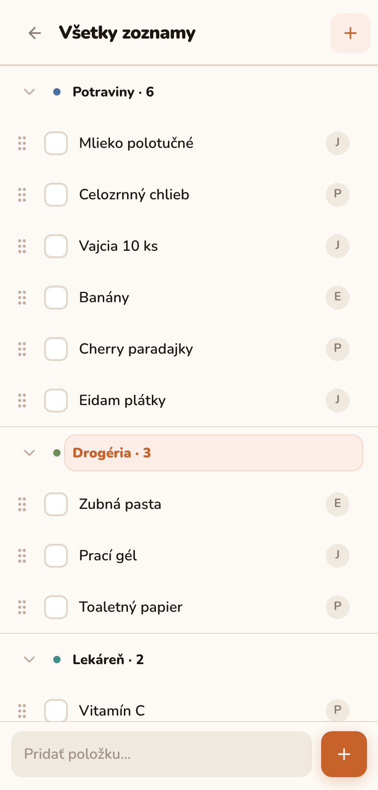
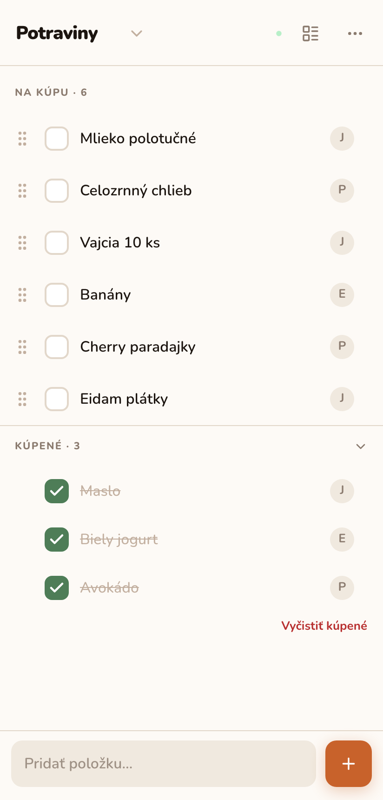
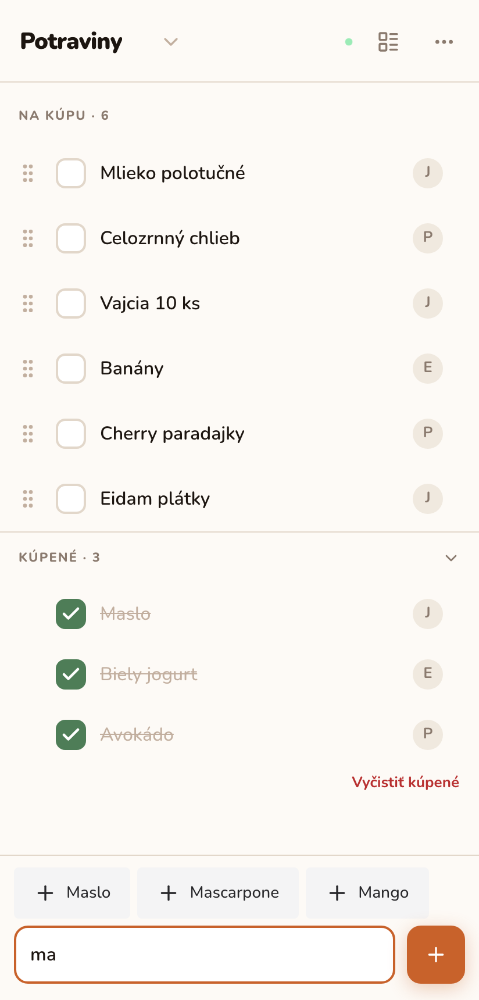

# From Coding Back to Product Design

Before heading to the shops, my wife and I used to compare shopping lists. She’d sent me a few things on Messenger and a few more on WhatsApp. I’d copied them into my notes, and she had notes of her own. Even after going through everything together, we’d still occasionally miss something.

For a while I’d been thinking that all we needed was one shared list on our phones. I knew how to build an app like that. There was always something more important to do, though, and by the next shop we’d be scrolling through our messages again.

I was already coding with AI most days. I’d usually read through the code the agent had written. If something looked odd, I’d ask why it had done it that way. The shopping list seemed like a good excuse to try this vibe coding thing I kept reading about. It was a small app for the two of us. If it made the shopping easier, I could live with a bit of unnecessary code.

## One list on two phones

When my wife adds milk, I want to see it on my phone straight away. And if I lose signal in the shop, I want to keep ticking off the things in my trolley. I remembered Firebase from a project a few years earlier. Firestore could sync changes across devices, and one family should fit comfortably within the free tier, hosting included.

I used Matt Pocock’s `grill-me` to work out the details. By then I was using the skill every day. I tell the agent what I’ve got in mind and it starts asking questions. What should happen, for instance, if I tap an item by mistake in the shop? We settled on moving it down to the bought section. One more tap would bring it back.

I reckon I had a first plan within an hour. The commits tell the rest of the story pretty well. At 16:08 on 1 July, there were two words on screen: “Zoznam nakupny” (shopping list).

By 18:20, one of us could add milk and the other could tick it off on their phone.

*The top of the screen, reconstructed from the [first commit on 1 July](https://github.com/FilipMessa/zoznam-nakupny/commit/270c42aff5a6cdbde5596ed4b814c0a375e47fa5).*

By that evening we could drag items into order with a finger, and the interface was in Slovak. I had a working prototype and I hadn’t seen a single line of code.

I tidied up Google sign-in and tried the app on both phones. I couldn’t wait to show my wife an item appearing on her phone as I added it on mine. Offline support came along too. When I added something without a signal, it showed up on her phone as soon as I got back online.

## A list for the cottage

What pleased me most was that after trying the app, we kept using it. I’d originally added multiple lists so we could keep groceries and toiletries separate. Then we went to the cottage and made a list called “Chata”. We wanted everything we needed to buy for the weekend in one place. In the shop I could open that list and find things we’d normally have put on separate lists at home.

A few months in, I caught myself typing out the name of something we’d bought only the week before. I only had to look a few rows down. It was still there under “Bought”. The button to clear that section had been there from the start. We just used it far less often than I’d expected.

## How milk ended up on the list three times

When I came back to the project, I wanted to type the first couple of letters and pick the item from a suggestion. My first thought was to hook up an AI model through an API. Then I looked at all those items under “Bought”. Did I really want to pay for the app to tell me what we usually bought when I had it all right there?

That’s where the first version got its suggestions. I started typing, the app found milk, and I tapped it. Lovely. Except that after I’d done it a few times, I had milk listed three times at the bottom.

I changed it so that tapping the suggestion brought the original milk entry back onto the shopping list. I bought it, ticked it off, and down it went again. That worked.

Then, after a shop, I tapped “Clear bought items”. The list was tidy. But when I started typing milk, the suggestion was gone. I’d cleared the only record the app had of us buying it.

**Why should tidying up my list make the app forget what we buy?**

I talked it through with the agent. What I called a second database at the time ended up being a separate collection in the same Firestore database. We called it `purchaseMemory`. Milk has one record shared by the whole family. When either of us ticks it off, its purchase count goes up. The app also remembers which list we bought it on. Now I can clear “Bought” and it’ll still suggest milk the next time we shop.

Here’s the little detail I was particularly pleased with. If I type “ma” in our groceries list, up come *maslo* (butter), mascarpone and mango. If we buy butter more often than mango on that list, butter comes first. And if butter is already on the list, the app skips it. I’d started out wondering which model to use. In the end, all I had to do was count what we bought.

I’ll come back to that when I tackle pasta. When we want two packets, we write “pasta 2×”. The two of us know what that means. As far as suggestions are concerned, though, “pasta” and “pasta 2×” are two different things. I want to give that one a bit more thought.

## When I opened the code again

On the second iteration I did open the code. I showed the agent the rules I use in another repo, and we went through a few rounds of code review. One thing I wanted to see was whether I could recognise the distinction I’d noticed while shopping. I can delete the milk I need to buy today. The fact that we buy milk still holds.

Books about UX were what got me into software in the first place. I wanted to design my own apps. I just didn’t know how to get them out of my head and into someone’s hands. So I learnt to code. Then I got a job and spent years helping other people build what they had in mind. I found a craft I enjoyed. I loved being able to write something complicated in a way that the next person could open up and understand straight away.

These days I open the list before I head to the shops. If my wife remembers we need milk, she adds it. I put it in my trolley and tick it off.

[Source code and screenshots](https://github.com/FilipMessa/zoznam-nakupny)
