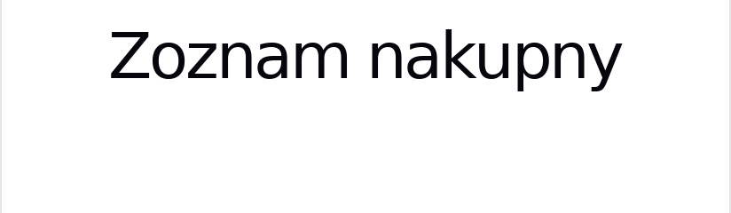
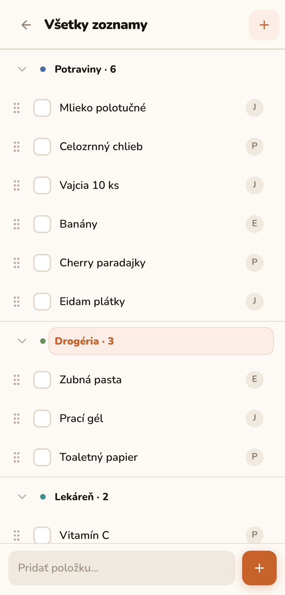
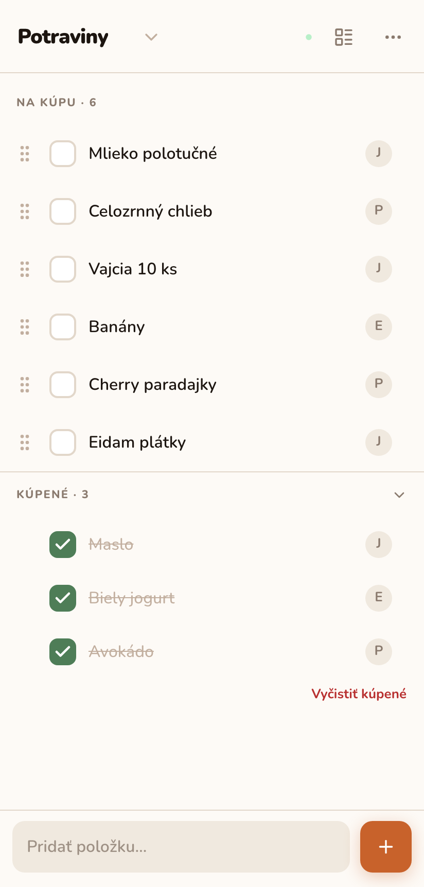
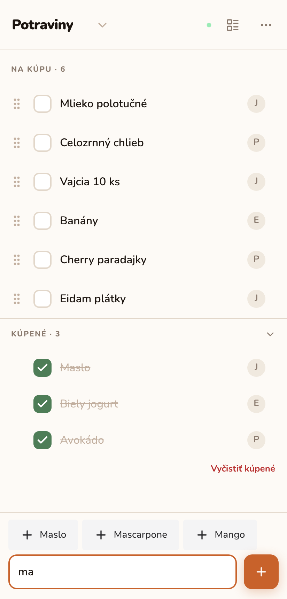

# Od programovania späť k produktu

Pred odchodom do obchodu sme si s manželkou zvykli porovnať nákupné zoznamy. Niečo mi poslala cez Messenger, niečo cez WhatsApp. Ja som si to prepísal do poznámok a ona mala ešte svoje. Aj keď sme to spolu prešli, občas nám niečo ušlo.

Už dávnejšie som si hovoril, že by nám stačil jeden spoločný zoznam v mobile. Takú appku som si vedel spraviť. Len vždy bolo niečo dôležitejšie a pred ďalším nákupom sme zase prechádzali správy.

S AI som už vtedy bežne programoval. Zvyčajne som si prešiel kód, ktorý agent napísal, a keď mi niečo nesedelo, pýtal som sa ho, prečo to spravil práve tak. Pri nákupnom zozname som si povedal, že skúsim ten vibe coding, o ktorom všade čítam. Bude to malá appka pre nás doma. Ak nám uľahčí nákupy, trochu balastu v kóde mi prekážať nebude.

## Jeden zoznam na dvoch telefónoch

Keď manželka pridá mlieko, chcem ho hneď vidieť aj na svojom telefóne. A keď v obchode stratím signál, chcem ďalej odškrtávať, čo už mám v košíku. Spomenul som si na Firebase, s ktorým som pár rokov predtým pracoval. Firestore vedel synchronizovať zmeny medzi zariadeniami a pri jednej rodine sme sa mali zmestiť do bezplatných limitov aj s hostingom.

Na spresnenie zadania som použil `grill-me` od Matta Pococka. Tento skill som už vtedy používal denne. Poviem agentovi, čo mám v hlave, a on sa začne vypytovať. Čo sa má napríklad stať, keď v obchode na niečo omylom ťuknem? Dohodli sme sa, že položka sa presunie dole medzi kúpené. Odtiaľ ju jedným ťuknutím vrátim späť.

Odhadujem, že do hodiny som mal prvý plán. Zvyšok sa dá celkom dobre vyčítať z commitov. Prvého júla o 16:08 boli na obrazovke dve slová: „Zoznam nakupny“.

O 18:20 už jeden z nás mohol pridať mlieko a druhý ho na svojom telefóne odškrtnúť.

*Rekonštrukcia hornej časti obrazovky podľa [prvého commitu z 1. júla](https://github.com/FilipMessa/zoznam-nakupny/commit/270c42aff5a6cdbde5596ed4b814c0a375e47fa5).*

Do večera sa položky dali presúvať prstom a rozhranie bolo po slovensky. Mal som funkčný prototyp a dovtedy som nevidel ani riadok kódu.

Doladil som prihlásenie cez Google a vyskúšal appku na oboch telefónoch. Nadšene som manželke ukazoval, ako sa položka pridaná na mojom telefóne objaví aj na jej. Postupne pribudlo aj fungovanie bez signálu. Keď som niečo dopísal bez signálu, na jej telefóne sa to objavilo, len čo som sa zase pripojil.

## Zoznam na chatu

Najviac ma potešilo, že sme pri appke zostali aj po prvom skúšaní. Viac zoznamov som pôvodne vymyslel kvôli potravinám a drogérii. Potom sme išli na chatu a založili sme si zoznam „Chata“. Chceli sme mať pokope všetko, čo treba kúpiť na víkend. V obchode som si otvoril Chatu a mal som tam aj veci, ktoré by sme si doma zapísali každú inam.

Po pár mesiacoch som sa pristihol, že zase vypisujem niečo, čo sme kúpili už minulý týždeň. Stačilo sa pritom pozrieť o pár riadkov nižšie. Medzi kúpenými sme to stále mali. Tlačidlo „Vyčistiť kúpené“ tam bolo od začiatku, len sme ho používali oveľa menej, než som čakal.

## Prečo sme mali trikrát mlieko

Keď som sa k projektu vrátil, chcel som napísať prvé dve písmená a zvyšok si vybrať z nápovedy. Ako prvé mi napadlo pripojiť nejaký AI model cez API. Potom som sa pozrel na tie kúpené položky. Naozaj chcem platiť za to, aby mi appka poradila, čo chodíme kupovať, keď to už mám rovno pred sebou?

Prvá verzia nápovedy čerpala odtiaľ. Začal som písať, appka našla mlieko a ja som naň ťukol. Paráda. Lenže keď som to párkrát zopakoval, mal som dole trikrát mlieko.

Upravil som to tak, aby sa po ťuknutí na nápovedu vrátilo medzi veci na kúpu to pôvodné mlieko. Kúpil som ho, odškrtol a presunulo sa zase dole. To fungovalo.

Potom som po nákupe ťukol na „Vyčistiť kúpené“. Zoznam som mal uprataný. Lenže keď som začal písať mlieko, v nápovede sa už neobjavilo. Appka o ňom vedela len vďaka tomu, že zostalo medzi kúpenými.

**Prečo by mala appka zabudnúť, čo kupujeme, len preto, že si upracem zoznam?**

Prebral som to s agentom. To, čomu som vtedy hovoril druhá databáza, je nakoniec len samostatná kolekcia v tom istom Firestore. Nazvali sme ju `purchaseMemory`. Mlieko v nej má jeden záznam pre celú rodinu. Keď ho niekto z nás odškrtne, pribudne k nemu jeden nákup. Appka si pamätá aj to, v ktorom zozname sme ho kúpili. Teraz môžem sekciu Kúpené vyčistiť a pri ďalšom nákupe mi mlieko ponúkne znova.

A z jednej drobnosti som mal fakt radosť. V Potravinách napíšem „ma“ a vyskočí maslo, mascarpone aj mango. Ak v tomto zozname kupujeme maslo častejšie než mango, ponúkne ho skôr. A ak už maslo na zozname mám, vynechá ho. Na začiatku som rozmýšľal, aký model vyberiem. Nakoniec stačilo počítať, čo doma kupujeme.

Ešte sa k tomu vrátim pri cestovinách. Keď chceme dve balenia, napíšeme „cestoviny 2ד. My dvaja tomu rozumieme. Pre nápovedu sú „cestoviny“ a „cestoviny 2ד dve rôzne veci. Toto si ešte chcem premyslieť.

## Keď som sa vrátil ku kódu

V druhej iterácii som už kód otvoril. Agentovi som ukázal pravidlá, ktoré používam v inom repozitári, a prešli sme niekoľko kôl code review. Zaujímalo ma okrem iného, či v kóde uvidím ten rozdiel, na ktorý som prišiel pri nakupovaní. Mlieko, ktoré mám dnes kúpiť, môžem zo zoznamu vymazať. To, že ho doma zvykneme kupovať, platí ďalej.

K softvéru ma kedysi priviedli knihy o UX. Chcel som navrhovať vlastné aplikácie, len som nevedel, ako ich dostať z hlavy niekomu do rúk. Tak som sa naučil programovať. Potom som sa zamestnal a roky som pomáhal realizovať nápady iných ľudí. Našiel som si v tom svoje remeslo. Mal som radosť, keď sa mi podarilo napísať niečo zložité tak, že ďalší človek otvoril kód a hneď mu rozumel.

Dnes pred odchodom do obchodu otvorím zoznam a idem. Keď si manželka ešte spomenie na mlieko, dopíše ho. Ja ho v obchode dám do košíka a odškrtnem.

[Zdrojový kód a screenshoty](https://github.com/FilipMessa/zoznam-nakupny)
