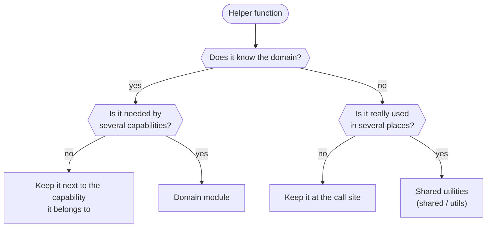

> 🇸🇰 [Slovenská verzia](README.sk.md)

# When Extracting a Function Makes Sense

A one-line function can save me from reading code. It can also add one more place I have to open. The line count won't tell me which of the two I'm looking at.

This piece follows on from the article "How I Think About Good Code Architecture". There, I judge a design by a single question:

> Is the context this change requires proportionate to what we're changing?

By context, I mean everything I have to understand to make the change correctly. Here I look at the question on a small scale, with a single helper function. I deal with two decisions: whether the function should exist at all, and where it belongs once it does.

## Deep modules and shallow modules

In his book *A Philosophy of Software Design*, John Ousterhout distinguishes between *deep modules* and *shallow modules*. He compares how much behavior a module provides with what its caller has to know.

A deep module provides a lot of behavior through a simple interface. A shallow module has an interface that is complex relative to what it provides. The interface includes not only the parameters and the return type, but also the overall behavior, side effects and constraints on usage.

Using a customer's orders as an example, I'll compare two boundaries. For each one, I ask what the caller has to know to use it, and what the boundary hides in return. If I extract only building the path, usage might look like this:

```ts
const path = getCustomerOrdersPath(customerId);
const url = new URL(path, getEnv().apiUrl).toString();
const response = await request<CustomerOrdersResponse>(url);
const orders = response.items;
```

To use the function, the caller has to know its name, and know that it takes `customerId` and returns a path without the API base URL. In return, the function hides a single line: the path template with the customer ID. There's almost as much to learn about it as it hides. That's why I consider it a shallow module.

The example also shows a second thing: the function covers only a small piece of the operation. The caller still has to resolve the base URL, make the request and pick the orders out of the response themselves. That alone doesn't make it a shallow module: every small function leaves some work to its caller.

If I move the boundary so that it covers fetching the customer's orders as a whole, the caller works with this operation:

```ts
const orders = await fetchCustomerOrders(customerId);
```

The caller needs to know the customer ID, the result and how it fails. Building the URL, executing the request and extracting the data from the response all stay behind the boundary. The ratio is reversed here: there's little to learn and a lot is hidden. This boundary comes close to what Ousterhout calls a deep module: through a simple interface, it provides behavior the caller would otherwise have to put together themselves.

So I judge depth by a ratio: what the caller has to know to use the boundary, versus what the boundary hides. It isn't determined by the number of lines, nor by the function having a single parameter.

## Should the function exist?

When splitting up code, it's possible to go too far. Every extracted function creates another contract and often another place the reader has to open. Ousterhout puts it directly in his lecture notes: "Every class and method introduces complexity with its interface."

So with a small function, I judge whether its name and boundary help me understand the behavior. Neither the number of lines nor the number of uses is enough for me to decide. I ask whether the boundary is deep enough: whether it hides something the caller would otherwise have to know. I'll still justify a shallow function when its name says something the expression itself doesn't show.

Let me return to the customer's orders, this time with the full code. The query library in the example is TanStack Query:

```ts
type CustomerOrdersResponse = { items: Order[] };

function getCustomerOrdersUrl(customerId: string): string {
  // apiUrl must end with "/", otherwise its last path segment is dropped.
  return new URL(
    `customers/${encodeURIComponent(customerId)}/orders`,
    getEnv().apiUrl,
  ).toString();
}

async function fetchCustomerOrders(customerId: string): Promise<Order[]> {
  const response = await request<CustomerOrdersResponse>(
    getCustomerOrdersUrl(customerId),
  );

  return response.items;
}

export function useCustomerOrdersQuery(customerId: string) {
  return useQuery({
    queryKey: ["customer-orders", customerId],
    queryFn: () => fetchCustomerOrders(customerId),
  });
}
```

I see three responsibilities in this example.

`getCustomerOrdersUrl()` builds the endpoint URL. It combines the path to a specific resource with the API base URL for the given environment. It's an infrastructure detail.

`fetchCustomerOrders()` is a client operation: the client's access to data on the server. It can execute the request and return the needed data from the response. It doesn't need to know how the query library handles the cache and the query lifecycle. The response type in `request<CustomerOrdersResponse>()` is only an assertion, though; with an API I don't trust, I would also validate the response at this boundary.

I see `useCustomerOrdersQuery()` as a separate integration layer that connects this operation to the query library. The `useGalleryQuery` and `useDeleteGalleryImage` hooks play the same role in the first article.

If I move the body of `fetchCustomerOrders()` directly into `queryFn`, the query library integration starts to know the request details and the response shape. A separate function makes sense here.

Even a short function like this can save me from reading more code. It's the same boundary as in the first example, the deeper of the two I compared. When I use it, I need to know three things: what to pass in, what it returns and how an error shows up.

The types tell me the first two: the function takes `customerId` and returns the orders on success. They don't tell me the third. `Promise<Order[]>` doesn't specify what error I get when the Promise rejects.

I can return expected failures as values and encode them in the return type, so the caller sees them directly in the contract. That's how the client operation `requestImageDeletion()` works in the first article: it returns every failure as a named reason. That still doesn't rule out an unexpected exception. If I leave errors as Promise rejections, the function's documentation should describe their behavior and tests should show specific cases. Otherwise I have to dig through the implementation, in this example including `request()`, and the boundary is shallower than it looks.

If I extracted the path as well, I wouldn't see that kind of value anymore. In the code above, the template is written right where the URL is built. The function from the first example would move it from there to yet another place:

```ts
function getCustomerOrdersPath(customerId: string): string {
  return `customers/${encodeURIComponent(customerId)}/orders`;
}
```

In the first example, it came out as a shallow module. Here, the way it would be used matters too. Its only caller would be `getCustomerOrdersUrl()`, which immediately combines the path with the base URL. Anyone who wants to know which URL the operation calls has to open both functions. The path has no rules of its own, and nobody works with it separately. So the function adds a place to open and saves very little. On top of that, its name says nothing the template doesn't already show. That's why I keep the template right where the URL is built.

I can ask the same question about a separate `getCustomerOrdersUrl()`, since it also has a single caller. Unlike the path, though, it hides more: building the entire URL, including the rule that the base URL must have a trailing slash, and where that base URL comes from. Without this function, `fetchCustomerOrders()` would reach directly into the environment configuration, which changes for different reasons than the request and the response shape. It's a borderline decision, and this boundary is weaker than the one between fetching the data and the query library integration. If the URL didn't depend on the environment, or if the HTTP client behind `request()` already added the base URL, I would move building the URL into `fetchCustomerOrders()`, just like the path.

So in this case, I would keep building the URL, fetching the data and the query library integration separate. I wouldn't extract the path on its own. I ended up with three functions because each one hides something; I didn't derive them from the number of responsibilities. For each boundary, I ask what it hides, and from whom.

## Where does the function belong?

Shared utilities, in projects often a `shared` or `utils` folder, provide technical behavior that is independent of the domain.

For example:

```ts
clamp(value, min, max);
groupBy(items, key);
debounce(callback, delay);
chunk(items, size);
```

These operations don't need to understand what a gallery, an order or an invoice means in the application.

It's different with the following functions from the gallery domain I use in the first article:

```ts
getImageDeletionBlocker(gallery);
prepareGalleryForPublishing(gallery);
```

Even if they're small, pure or reusable, they know the domain. Their meaning is tied to the gallery and its rules.

I keep behavior like this close to the capability it belongs to. I use the word capability for behavior the system provides, such as deleting an image from a gallery. If a domain function is needed by several capabilities, or by both the client and the server, like `getImageDeletionBlocker()` in the first article, it belongs in its domain module. It's shared, but it still knows the domain.

I move behavior into shared utilities only when several places really use it and its responsibility doesn't depend on the domain. A domain function there would widen the required context: when changing a rule, I'd have to look for it outside the rule's domain.



Reusability alone doesn't tell me where a function belongs. I need to know what responsibility it carries.

## Back to the question

I judge both decisions the same way. I extract a function when what it hides is worth more than the cost of its interface and one more place to open. I place it according to the responsibility it carries; reuse alone isn't enough for that. In both cases, I come back to the same question:

> Is the context this change requires proportionate to what we're changing?

## Sources

- Previous article: "How I Think About Good Code Architecture".
- John Ousterhout: *A Philosophy of Software Design*, Yaknyam Press, April 2018 ([the author's list of publications](https://web.stanford.edu/%7Eouster/cgi-bin/publications.php)).
- John Ousterhout: [Modular Design](https://web.stanford.edu/~ouster/cgi-bin/cs190-winter18/lecture.php?topic=modularDesign), lecture notes for CS 190, Stanford University, Winter 2018.
- TypeScript: [useUnknownInCatchVariables](https://www.typescriptlang.org/tsconfig/#useUnknownInCatchVariables), documentation on the type of an error caught in `catch`.
