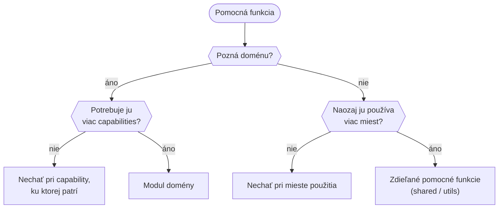

> 🇬🇧 [English version](README.md)

# Kedy má oddelenie funkcie zmysel

Jednoriadková funkcia mi vie ušetriť čítanie kódu. Vie mi však aj pridať ďalšie miesto, ktoré musím otvoriť. Podľa počtu riadkov jedno od druhého nerozlíšim.

Tento text nadväzuje na článok „Ako vnímam dobrú architektúru kódu“. Tam posudzujem návrh jednou otázkou:

> Je kontext potrebný na túto zmenu primeraný tomu, čo meníme?

Kontextom myslím všetko, čo musím pochopiť, aby som zmenu urobil správne. Tu sa na otázku pozerám v malom, pri jednej pomocnej funkcii. Riešim dve rozhodnutia: či má funkcia vôbec vzniknúť a kam patrí, keď už vznikla.

## Deep module a shallow module

John Ousterhout v knihe *A Philosophy of Software Design* rozlišuje *deep modules* a *shallow modules*. Porovnáva pritom, koľko správania modul poskytuje, s tým, čo musí vedieť ten, kto ho volá.

Deep module poskytuje veľa správania cez jednoduché rozhranie. Shallow module má rozhranie zložité vzhľadom na to, čo poskytuje. Do rozhrania pritom patrí aj celkové správanie, vedľajšie účinky a podmienky použitia, nielen parametre a návratový typ.

Na príklade objednávok zákazníka porovnám dve hranice. Pri každej sa pýtam, čo musí volajúci vedieť, aby ju použil, a čo za to hranica skryje. Ak oddelím iba zostavenie cesty, použitie môže vyzerať takto:

```ts
const path = getCustomerOrdersPath(customerId);
const url = new URL(path, getEnv().apiUrl).toString();
const response = await request<CustomerOrdersResponse>(url);
const orders = response.items;
```

Aby volajúci funkciu použil, musí poznať jej názov a vedieť, že prijíma `customerId` a vracia cestu bez základnej adresy API. Funkcia za to skryje jediný riadok: šablónu cesty s identifikátorom zákazníka. To, čo sa o nej treba naučiť, je takmer také rozsiahle ako to, čo skrýva. Preto ju považujem za shallow module.

Z ukážky vidno aj druhú vec: funkcia pokrýva len malý kúsok operácie. Základnú adresu, požiadavku aj výber objednávok z odpovede si volajúci stále skladá sám. To samo osebe z nej shallow module nerobí: nejakú prácu nechá volajúcemu každá malá funkcia.

Ak hranicu posuniem tak, aby zahŕňala celé získanie objednávok zákazníka, volajúci pracuje s touto operáciou:

```ts
const orders = await fetchCustomerOrders(customerId);
```

Volajúci potrebuje poznať identifikátor zákazníka, výsledok a spôsob zlyhania. Za hranicou zostáva zostavenie URL, vykonanie požiadavky aj výber dát z odpovede. Pomer je tu opačný: naučiť sa treba málo a skryté je toho veľa. Táto hranica sa blíži tomu, čo Ousterhout nazýva deep module: cez jednoduché rozhranie poskytuje správanie, ktoré by si volajúci inak musel poskladať sám.

Hĺbku teda posudzujem podľa pomeru: čo musí volajúci vedieť, aby hranicu použil, oproti tomu, čo hranica skryje. Počet riadkov ju neurčuje, ani to, že funkcia má jediný parameter.

## Má funkcia vzniknúť?

Pri rozdeľovaní kódu sa dá zájsť aj príliš ďaleko. Každá oddelená funkcia vytvára ďalší kontrakt a často aj ďalšie miesto, ktoré musí čitateľ otvoriť. Ousterhout to v poznámkach k prednáške hovorí priamo: „Every class and method introduces complexity with its interface.“

Preto pri malej funkcii posudzujem, či jej názov a hranica pomáhajú pochopiť správanie. Počet riadkov ani počet použití mi na rozhodnutie nestačí. Pýtam sa, či je hranica dosť hlboká: či skrýva niečo, čo by inak musel poznať volajúci. Plytkú funkciu si obhájim aj vtedy, keď jej názov povie niečo, čo zo samotného výrazu nevidno.

Vrátim sa k objednávkam zákazníka, tentoraz s celým kódom. Query knižnicou je v ukážke TanStack Query:

```ts
type CustomerOrdersResponse = { items: Order[] };

function getCustomerOrdersUrl(customerId: string): string {
  // apiUrl must end with "/", otherwise its last path segment is dropped.
  return new URL(
    `customers/${encodeURIComponent(customerId)}/orders`,
    getEnv().apiUrl,
  ).toString();
}

async function fetchCustomerOrders(customerId: string): Promise<Order[]> {
  const response = await request<CustomerOrdersResponse>(
    getCustomerOrdersUrl(customerId),
  );

  return response.items;
}

export function useCustomerOrdersQuery(customerId: string) {
  return useQuery({
    queryKey: ["customer-orders", customerId],
    queryFn: () => fetchCustomerOrders(customerId),
  });
}
```

V tomto príklade vidím tri zodpovednosti.

`getCustomerOrdersUrl()` zostavuje URL endpointu. Spája cestu ku konkrétnemu zdroju so základnou adresou API daného prostredia. Je to detail infraštruktúry.

`fetchCustomerOrders()` je klientska operácia, prístup klienta k dátam na serveri. Vie vykonať požiadavku a z odpovede vrátiť potrebné dáta. Nemusí vedieť, ako query knižnica pracuje s cache a životným cyklom dotazu. Typ odpovede v `request<CustomerOrdersResponse>()` je pritom iba tvrdenie; pri API, ktorému neverím, by som odpoveď na tejto hranici aj overil.

`useCustomerOrdersQuery()` vnímam ako samostatnú integračnú vrstvu, ktorá túto operáciu napája na query knižnicu. Rovnakú rolu majú v prvom článku hooky `useGalleryQuery` a `useDeleteGalleryImage`.

Ak telo `fetchCustomerOrders()` presuniem priamo do `queryFn`, integrácia s query knižnicou začne poznať detaily požiadavky aj štruktúru odpovede. Samostatná funkcia tu má zmysel.

Aj takáto krátka funkcia mi vie ušetriť čítanie ďalšieho kódu. Je to tá istá hranica ako v prvej ukážke, hlbšia z dvoch, ktoré som porovnával. Keď ju používam, potrebujem vedieť tri veci: čo jej odovzdať, čo mi vráti a ako sa prejaví chyba.

Prvé dve mi povedia typy: funkcia prijíma `customerId` a pri úspechu vráti objednávky. Tretiu nie. `Promise<Order[]>` neurčuje, akú chybu dostanem, keď sa Promise zamietne.

Očakávané zlyhania môžem vracať ako hodnoty a zapísať ich do návratového typu, aby ich volajúci videl priamo v kontrakte. V prvom článku tak funguje klientska operácia `requestImageDeletion()`: každé zlyhanie vracia ako pomenovaný dôvod. Neočakávanú výnimku tým ešte nevylúčim. Ak chyby nechám ako zamietnutie Promise, ich správanie by mala opisovať dokumentácia funkcie a konkrétne prípady ukazovať testy. Inak ich musím dohľadať v implementácii, v tomto príklade aj vo funkcii `request()`, a hranica je plytšia, než vyzerá.

Keby som oddelil ešte aj cestu, takú hodnotu už nevidím. V kóde vyššie je šablóna zapísaná priamo pri zostavovaní URL. Funkcia z prvej ukážky by ju odtiaľ presunula na ďalšie miesto:

```ts
function getCustomerOrdersPath(customerId: string): string {
  return `customers/${encodeURIComponent(customerId)}/orders`;
}
```

V prvej ukážke vyšla ako shallow module. Tu pribúda spôsob jej použitia. Jediným volajúcim by bola `getCustomerOrdersUrl()`, ktorá cestu hneď spája so základnou adresou. Kto chce vedieť, akú adresu operácia volá, otvorí obe funkcie. Vlastné pravidlá cesta nemá a nikto s ňou samostatne nepracuje. Funkcia tak pridá miesto, ktoré treba otvoriť, a ušetrí veľmi málo. Jej názov navyše nepovie nič, čo zo šablóny nevidno. Preto šablónu nechávam priamo pri zostavovaní URL.

Rovnako sa môžem spýtať, či má zmysel samostatná `getCustomerOrdersUrl()`, pretože aj ona má jediného volajúceho. Na rozdiel od cesty však skrýva viac: celé zostavenie adresy vrátane pravidla, že základná adresa musí končiť lomkou, a to, odkiaľ sa táto adresa berie. Bez tejto funkcie by `fetchCustomerOrders()` siahala priamo na konfiguráciu prostredia, ktorá sa mení z iných dôvodov než požiadavka a tvar odpovede. Je to rozhodnutie na hrane a táto hranica je slabšia než hranica medzi získaním dát a integráciou s query knižnicou. Keby adresa od prostredia nezávisela alebo by ju dopĺňal už HTTP klient za `request()`, presunul by som zostavenie URL do `fetchCustomerOrders()`, rovnako ako cestu.

V tomto prípade by som teda ponechal oddelené zostavenie URL, získanie dát a integráciu s query knižnicou. Cestu by som samostatne neoddeľoval. Tri funkcie mi vyšli preto, že každá niečo skrýva; z počtu zodpovedností som ich neodvodil. Pri každej hranici sa pýtam, čo skryje a komu.

## Kam funkcia patrí?

Zdieľané pomocné funkcie, v projektoch často priečinok `shared` alebo `utils`, poskytujú technické správanie nezávislé od domény.

Napríklad:

```ts
clamp(value, min, max);
groupBy(items, key);
debounce(callback, delay);
chunk(items, size);
```

Tieto operácie nepotrebujú rozumieť tomu, čo v aplikácii znamená galéria, objednávka alebo faktúra.

Pri nasledujúcich funkciách z domény galérie, ktorú používam v prvom článku, je to inak:

```ts
getImageDeletionBlocker(gallery);
prepareGalleryForPublishing(gallery);
```

Aj keď sú malé, čisté alebo opakovane použiteľné, poznajú doménu. Ich význam súvisí s galériou a jej pravidlami.

Takéto správanie nechávam blízko capability, ku ktorej patrí. Slovom capability označujem správanie, ktoré systém poskytuje, napríklad vymazanie obrázka z galérie. Ak doménovú funkciu potrebuje viac capabilities alebo klient aj server, ako `getImageDeletionBlocker()` v prvom článku, patrí do modulu svojej domény. Zdieľaná je, ale doménu stále pozná.

Medzi zdieľané pomocné funkcie presúvam správanie až vtedy, keď ho naozaj používa viac miest a jeho zodpovednosť od domény nezávisí. Doménová funkcia by tam potrebný kontext rozširovala: pri zmene pravidla by som ju musel hľadať mimo jeho domény.



Samotná opakovaná použiteľnosť funkcie mi ešte nehovorí, kam patrí. Potrebujem vedieť, akú zodpovednosť nesie.

## Späť k otázke

Obe rozhodnutia posudzujem rovnako. Funkciu oddeľujem, keď skryje viac, než stojí jej rozhranie a ďalšie miesto, ktoré treba otvoriť. Umiestňujem ju podľa zodpovednosti, ktorú nesie; opakované použitie mi na to nestačí. V oboch prípadoch sa vraciam k tej istej otázke:

> Je kontext potrebný na túto zmenu primeraný tomu, čo meníme?

## Zdroje

- Predchádzajúci článok: „Ako vnímam dobrú architektúru kódu“.
- John Ousterhout: *A Philosophy of Software Design*, Yaknyam Press, apríl 2018 ([zoznam publikácií autora](https://web.stanford.edu/%7Eouster/cgi-bin/publications.php)).
- John Ousterhout: [Modular Design](https://web.stanford.edu/~ouster/cgi-bin/cs190-winter18/lecture.php?topic=modularDesign), poznámky k prednáške CS 190, Stanford University, zima 2018.
- TypeScript: [useUnknownInCatchVariables](https://www.typescriptlang.org/tsconfig/#useUnknownInCatchVariables), dokumentácia k typu chyby zachytenej v `catch`.
